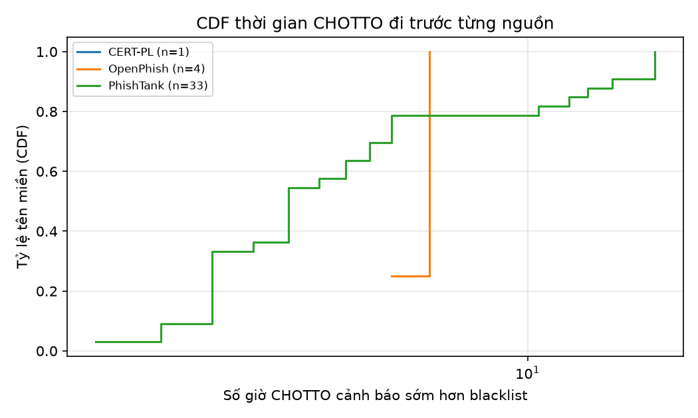

# Khoảng trống zero-day của link lừa đảo: CHOTTO (Tầng 2) đi trước blacklist bao lâu?

> **Trạng thái (19/11/2026):** công cụ đo đã xong, báo cáo đã có số liệu tạm trên 2,61 ngày dữ liệu. Mọi chỗ đánh dấu **[CẦN CẬP NHẬT]** phải điền lại sau khi thu thập đủ ≥ 3 ngày (khuyến nghị 7 ngày).
> Cách cập nhật nằm ở cuối file.

## 1. Đặt vấn đề

Blacklist chỉ chặn được một link **sau khi** có người báo cáo hoặc hệ thống của nhà cung cấp quét ra nó. Lừa đảo
trên Zalo thì ngược lại: tên miền thường được đăng ký, dùng trong vài giờ đến vài ngày rồi bỏ. Khoảng thời gian từ lúc
link bắt đầu lan truyền đến lúc nó lọt vào blacklist là **khoảng trống zero-day**, và trong khoảng này blacklist
không giúp được người nhận link.

CHOTTO có ba tầng: Tầng 1 là blacklist, Tầng 2 là heuristic tiếng Việt chạy cục bộ (hình dạng tên miền, từ khóa
dụ dỗ, mạo danh thương hiệu, link bọc...), Tầng 3 tra tuổi tên miền. Tầng 2 không cần ai báo cáo trước nên là phần
duy nhất của CHOTTO có thể lấp khoảng trống này.

**Câu hỏi nghiên cứu.** *CHOTTO, chỉ dùng Tầng 2 (không blacklist, không tra tuổi), cảnh báo được bao nhiêu % tên miền
lừa đảo mới ngay lúc thấy lần đầu, và sớm hơn từng blacklist bao nhiêu giờ?*

## 2. Các công trình và nguồn liên quan

- **Blacklist cộng đồng và thương mại.** Phishing.Database (mitchellkrogza, giấy phép MIT), OpenPhish (feed công
  khai), PhishTank, URLhaus (abuse.ch). Chúng khác nhau về cách thu thập (báo cáo của người dùng, crawler, kiểm tra
  còn sống) nên độ trễ khác nhau.
- **Google Safe Browsing.** Dịch vụ lớn nhất, tích hợp trong trình duyệt. Nó cũng là danh sách, nên cùng bản chất:
  chỉ có hiệu lực sau khi URL được phát hiện và phân loại. Báo cáo này **không đo** Safe Browsing vì không có feed
  công khai đủ để so sánh theo thời gian mà không gửi URL cho dịch vụ bên ngoài (xem mục Hạn chế).
- **ChongLuaDao.** Dự án cộng đồng Việt Nam, nguồn blacklist chính của CHOTTO (`rules.json`, `blacklist_sources`).
  Đây là nguồn có giá trị nhất để so sánh vì nhắm đúng bối cảnh Việt Nam, nhưng API của họ **không truy cập được**
  trong đợt đo này (xem mục 4).
- **Độ chính xác tĩnh của CHOTTO.** `docs/BAO-CAO-DO-CHINH-XAC.md` đo Tầng 2 trên một danh sách lừa đảo cố định (không
  có yếu tố thời gian): bắt được 24,4% link nhắm VN và 40,6% link toàn cầu ở v1.3. Báo cáo này đặt thêm trục thời
  gian, nên nó cho biết Tầng 2 đi trước blacklist bao lâu chứ không chỉ bắt được bao nhiêu phần trăm.

## 3. Phương pháp

Công cụ: `tools/zero_day_gap.py` (chỉ dùng thư viện chuẩn). Dữ liệu nằm trong SQLite `.zero-day/zero_day.sqlite3`.

1. **Thu thập.** Cứ 30 phút (`tools/schedule_zero_day.ps1`, Task Scheduler) lệnh `collect` tải các feed:
   OpenPhish, PhishTank (CSV, cập nhật hàng giờ) và CERT Polska (`hole.cert.pl`, danh sách tên miền độc hại), kèm URLhaus
   và ChongLuaDao (hiện lỗi, vẫn thử lại). Từ 17/11/2026 bỏ Phishing.Database vì kho ngừng cập nhật (xem 4.1).
2. **Ghi nhận lần đầu.** Với mỗi *tên miền đăng ký được* (theo Public Suffix List, gồm cả phần PRIVATE nên
   `x.weeblysite.com` được tính riêng), lưu thời điểm nó xuất hiện lần đầu ở **từng nguồn**.
3. **Baseline.** Lần chạy thành công đầu tiên của mỗi nguồn là baseline. Tên miền chỉ thấy ở baseline bị loại vì
   không biết chúng đã tồn tại từ bao giờ. Tên miền nằm trong baseline của nguồn nào thì nguồn đó bị loại khỏi thống kê
   của riêng tên miền đó.
4. **Chấm điểm ngay lúc thấy.** Tên miền mới (chưa nguồn nào từng có) được chấm bằng `Engine` với Tầng 1 và Tầng 3
   tắt, nên không có mạng và không có blacklist. Feed chỉ có tên miền thì chấm dưới dạng `https://tên-miền/`; feed có
   URL đầy đủ thì chấm URL đó. Mốc T0 là thời điểm lần chạy `collect` phát hiện ra tên miền.
5. **Chỉ số.**
   - *Tỷ lệ cảnh báo*: điểm ≥ ngưỡng friction trong `rules.json` (30), tách nhóm nhắm VN (đuôi `.vn` hoặc chứa thương
     hiệu VN, cùng tiêu chí với `eval_accuracy.py`) và toàn cầu.
   - *Với từng nguồn*: số tên miền chưa được liệt kê, liệt kê muộn hơn, cùng lúc; và Q1/trung vị/Q3 của (giờ nguồn
     liệt kê − T0), chỉ tính tên miền CHOTTO cảnh báo được.
6. **Giữ khách quan.** `chotto/data/rules.json` và logic engine **không được sửa** trong thời gian đo. Ý tưởng cải
   tiến luật ghi ở `docs/Y-TUONG-CAI-TIEN.md`.

Kiểm thử: `tests/test_zero_day_gap.py` (17 bài, feed giả `file://`, không gọi mạng).

## 4. Kết quả

### 4.1. Tình trạng thu thập

Lần thu thập đầu tiên (16/11/2026 13:41 UTC), thực tế:

| Nguồn | Kết quả | Mục baseline |
| --- | --- | ---: |
| Phishing.Database ACTIVE (domains) | tải được | 290.421 |
| OpenPhish | tải được | 261 |
| Phishing.Database NEW-last-hour (links) | tải được, nhưng file **rỗng** lúc đó | 0 |
| URLhaus (`text_recent`) | **lỗi HTTP 410 Gone** (bản tải công khai không còn phục vụ) | – |
| ChongLuaDao (`api.chongluadao.vn/v1/blacklist`) | **lỗi DNS**, tên miền API không phân giải | – |

Đã thử bản sao cộng đồng của ChongLuaDao (`vn-badsite-filter`): tải được nhưng ngừng cập nhật từ 11/04/2025 nên không dùng. **Phát hiện ngày 17/11/2026:** kho Phishing.Database có commit cuối vào 02/10/2026; feed NEW-last-hour luôn rỗng và
ACTIVE giữ nguyên 290.421 mục suốt 15 giờ đo, nên hai feed này không cho dữ liệu thời gian. Sau 35 lần chạy, chỉ
OpenPhish thêm mục mới (240 tên miền), vì vậy 230 tên miền đã chấm trong ngày đầu đều do OpenPhish phát hiện và **chưa
so sánh được với nguồn thứ hai**. Đã thêm PhishTank và CERT-PL (baseline CERT-PL: 103.064 mục); PhishTank trả
HTTP 429 (giới hạn tần suất tải) ở lần thử đầu, cần theo dõi. Các tên miền đã chấm trước khi một nguồn mới vào đo có thể nằm
trong baseline của nguồn đó và bị loại riêng khỏi thống kê của nguồn đó (cắt trái). Hai nguồn lỗi vẫn nằm trong cấu hình để mỗi lần chạy thử lại; nếu chúng sống lại, lần thành công đầu tiên sẽ là
baseline. **[CẦN CẬP NHẬT]** bảng tỷ lệ tải thành công theo nguồn từ `python tools/zero_day_gap.py status`.

### 4.2. Tỷ lệ cảnh báo ngay lúc thấy lần đầu

**Số liệu tạm: 2,61 ngày, 131 lần thu thập, 3.310 tên miền mới (chốt 19/11/2026 04:18 UTC). [CẦN CẬP NHẬT khi đủ 3 ngày]**

| Nhóm | Số tên miền mới | Cảnh báo | Tỷ lệ | Mức HIGH |
| --- | ---: | ---: | ---: | ---: |
| Tất cả | 3.310 | 1.330 | 40,2% | 814 |
| Nhắm VN | 69 | 69 | 100% | 69 |
| Toàn cầu | 3.241 | 1.261 | 38,9% | 745 |

Cách đọc đúng các con số này:

- **Con số 40,2% là kết quả của cơ cấu mẫu, không phải một năng lực duy nhất.** Tỷ lệ bắt phụ thuộc rất mạnh vào nguồn
  phát hiện tên miền: OpenPhish (cho URL đầy đủ) 86% (1.026/1.195), PhishTank 23% (36/156), CERT-PL (chỉ có tên
  miền, nhiều tên miền thương mại thông thường) 14% (268/1.959). CERT-PL chiếm 59% mẫu nên kéo con số chung xuống.
- **Nhóm "nhắm VN" 100% là vì cách xác định nhóm**: tên miền chứa từ khóa thương hiệu VN thì chính từ khóa đó cũng làm
  Tầng 2 chấm điểm cao (mạo danh thương hiệu). Với n = 69, đây là cận trên, không phải tỷ lệ bắt thật với link nhắm VN.
- Kết quả tương đối nhất quán với `BAO-CAO-DO-CHINH-XAC.md` (40,6% link toàn cầu trên danh sách tĩnh), dù hai phép đo khác
  nhau về nguồn dữ liệu.


### 4.3. CHOTTO đi trước từng nguồn bao nhiêu giờ

**Số liệu tạm (2,61 ngày). [CẦN CẬP NHẬT khi đủ 3 ngày]** "Xét" là số tên miền không nằm trong baseline của nguồn đó.

| Nguồn | Xét | Chưa liệt kê | Liệt kê muộn hơn | Cùng lúc | Sớm hơn Q1 / trung vị / Q3 (giờ) |
| --- | ---: | ---: | ---: | ---: | --- |
| OpenPhish | 3.310 | 2.095 | 20 | 1.195 | 6,2 / 6,5 / 6,5 |
| PhishTank | 3.296 | 3.079 | 59 | 158 | 2,5 / 3,5 / 5,5 |
| CERT-PL | 3.309 | 1.349 | 1 | 1.959 | 5,5 (một mẫu) |

Phần lớn tên miền nằm ở "chưa liệt kê" hoặc "cùng lúc" nên **số mẫu để tính độ trễ rất nhỏ** (cột cuối chỉ tính tên
miền CHOTTO cảnh báo được và nguồn liệt kê muộn hơn: 33 mẫu với PhishTank, 4 với OpenPhish, 1 với CERT-PL). Kết luận
tạm thời: với PhishTank, trung vị CHOTTO đi trước khoảng 3,5 giờ; với OpenPhish và CERT-PL chưa đủ mẫu để nói gì. Cột
"cùng lúc" của mỗi nguồn gồm cả các tên miền do chính nguồn đó phát hiện đầu tiên, nên không phản ánh tốc độ của nó.
PhishTank bị giới hạn tần suất nên chỉ tải mỗi giờ một lần từ 18/11, độ phân giải thời điểm liệt kê của nó thô hơn
(khoảng 1 giờ) so với hai nguồn còn lại.



### 4.4. Vì sao một số tên miền lọt

**Số liệu tạm. [CẦN CẬP NHẬT khi đủ 3 ngày]** 1.980 tên miền bị bỏ sót (điểm < 30).

- **Phân bố điểm lưỡng cực:** 1.899 tên miền (57%) có điểm dưới 20, còn nhóm 60 trở lên có 814 tên miền. Tức là Tầng 2
  hoặc thấy rất rõ hoặc gần như không thấy gì; rất ít tên miền nằm lưng chừng ngưỡng 30 (chỉ 81 ở khoảng 20-29).
- **Dấu hiệu giúp bắt được:** `free_hosting` (1.120), `entropy` (892), `hyphens` (828), `http` (531), `digits` (372).
  Chỉ 67 tên miền bắt được nhờ `combosquat` và 6 nhờ `typosquat`: cơ chế mạo danh thương hiệu hiếm khi kích hoạt trong mẫu này.
- **Vì sao lọt:** 691 trong 1.980 tên miền bị bỏ sót có đúng một dấu hiệu `tld` (đuôi rẻ tiền) nhưng điểm không đủ ngưỡng;
  phần lớn số còn lại không có dấu hiệu nào hoặc chỉ có dấu hiệu nhẹ (`entropy` 82, `digits` 63, `http` 62, `hyphens` 55), tức là tên miền trông như một tên miền thương mại bình thường. Đuôi hay lọt:
  `.com` (586), `.shop` (393), `.digital` (140), `.pro` (135), `.store` (104).
- **Tập trung theo chiến dịch:** nhiều tên miền lọt là biến thể của cùng một chiến dịch (ví dụ họ `addliq*.com`,
  `truly*`, `insta*`, `roblo*`), nên số đếm bị một vài chiến dịch lớn chi phối.
- **Không có tên miền nào lọt nằm trên nền tảng hosting miễn phí**: các tên miền này được tính theo hậu tố PRIVATE của PSL
  và đều được cảnh báo.

Danh sách mẫu bị bỏ sót nằm trong `docs/zero-day-report.md`. Ý tưởng cải tiến (làm sau khi đo xong) nằm ở
`docs/Y-TUONG-CAI-TIEN.md`.

## 5. Hạn chế

1. **Độ phân giải theo chu kỳ thu thập.** Mọi thời điểm là thời điểm của lần chạy `collect` (30 phút). "Cùng lúc"
   nghĩa là cùng một lần chạy, không phải cùng một giây. Chênh lệch dưới 30 phút không đo được. Máy tắt hoặc ngủ thì
   chu kỳ bị kéo dài và mốc T0 bị trễ.
2. **Mẫu thiên lệch về link đã bị báo cáo.** Chỉ những tên miền cuối cùng lọt vào một feed mới có mặt trong dữ liệu.
   Link lừa đảo không bao giờ được báo cáo thì vắng mặt, nên tỷ lệ bắt có thể không đại diện cho toàn bộ lừa đảo trên
   Zalo. Ngoài ra, tên miền lừa đảo nhắm riêng người Việt qua Zalo có thể ít được các feed quốc tế thu thập.
3. **Không biết thời điểm tên miền thực sự được dùng để lừa.** T0 là lúc nghiên cứu thấy tên miền ở một feed, không
   phải lúc nạn nhân nhận link. Tên miền có thể đã lưu hành từ trước, nên khoảng "CHOTTO sớm hơn" tính được là **cận
   dưới** của khoảng trống thật, còn tỷ lệ "chưa liệt kê" bị cắt phải (nguồn có thể liệt kê sau khi đo xong).
4. **Nguồn lỗi.** URLhaus (HTTP 410) và ChongLuaDao (DNS) không tải được, nên báo cáo thiếu đúng nguồn có ý nghĩa
   nhất với Việt Nam. Kết luận chỉ áp dụng cho các nguồn thực sự đo được.
5. **Không đo Google Safe Browsing.** Tra từng URL qua dịch vụ ngoài vi phạm nguyên tắc không gửi URL ra ngoài các feed
   đã liệt kê, và API cần khóa.
6. **Ảnh hưởng của feed chỉ có tên miền.** Phishing.Database ACTIVE chỉ có tên miền, nên điểm của nó được tính khi mất
   đường dẫn và tham số (nhiều tín hiệu của Tầng 2 nằm ở đó), có thể làm tỷ lệ bắt thấp hơn thực tế.
7. **Nhóm "nhắm VN" xác định bằng quy tắc** (đuôi `.vn` hoặc từ khóa thương hiệu), không phải nhãn thật; tên miền
   chứa từ khóa thương hiệu có thể là trang hợp pháp bị nhầm. Cỡ mẫu nhóm này có thể rất nhỏ.
8. **Tên miền đăng ký theo PSL** coi từng subdomain trên nền tảng hosting (PRIVATE) là một tên miền riêng, nên một
   chiến dịch lớn trên cùng nền tảng có thể làm lệch số đếm.

## 6. Kết luận

**Kết luận tạm thời (2,61 ngày dữ liệu, 3.310 tên miền mới). [CẦN CẬP NHẬT khi đủ 3 ngày]**

1. **Tỷ lệ bắt zero-day.** CHOTTO chỉ với Tầng 2 cảnh báo được khoảng 40% tên miền lừa đảo mới ngay lần đầu thấy
   (38,9% nhóm toàn cầu). Con số này phụ thuộc mạnh vào nguồn: 86% với tên miền từ OpenPhish (có URL đầy đủ) nhưng chỉ
   14-23% với tên miền từ CERT-PL/PhishTank (thường chỉ có tên miền, trông bình thường). Con số 100% của nhóm nhắm VN
   chưa đáng tin vì n = 69 và nhóm được xác định bằng đúng tín hiệu thương hiệu.
2. **Khoảng trống zero-day.** Với những tên miền Tầng 2 bắt được mà blacklist liệt kê sau, PhishTank liệt kê muộn hơn trung vị khoảng
   3,5 giờ (Q1 2,5, Q3 5,5; 33 mẫu). Với OpenPhish và CERT-PL số mẫu quá ít. Phần lớn tên miền (2.095 với OpenPhish, 3.079 với PhishTank) chưa
   được nguồn đó liệt kê trong thời gian đo, nên khoảng trống thật có thể lớn hơn con số này (dữ liệu bị cắt phải).
3. **Phần lọt.** Tầng 2 bỏ sót hai nhóm chính: tên miền có đuôi rẻ tiền nhưng không có dấu hiệu nào khác, và tên miền
   thương mại bình thường không mạo danh thương hiệu. Đây là giới hạn của heuristic chỉ dựa vào hình dạng tên miền;
   Tầng 3 (tuổi tên miền) và blacklist là những lớp bổ sung cho nhóm này.
4. Các hạn chế ở mục 5 nghĩa là các con số là **cận dưới/giá trị tham khảo** và chỉ áp dụng cho các nguồn đo được. Chưa nên
   trích con số cụ thể ra ngoài báo cáo này khi chưa cập nhật bản cuối.

---

## Cách cập nhật số liệu

```
python tools/zero_day_gap.py status
python tools/zero_day_gap.py report --md docs/zero-day-report.md --json docs/zero-day-report.json
python tools/zero_day_gap.py plot --out docs
```

rồi điền lại các mục **[CẦN CẬP NHẬT]** ở trên từ `docs/zero-day-report.md`.
