# Chế độ người giám hộ (Guardian mode)

Tính năng của **tiện ích trình duyệt CHOTTO** (Chrome/Edge, MV3) cho kịch bản *con cái bảo vệ bố mẹ lớn tuổi khỏi lừa đảo Zalo* (và ngược lại).
Nhánh làm việc: `guardian-mode` (tách từ `ui-redesign`). Không sửa engine chấm điểm và `chotto/data/rules.json`. Mọi thứ chạy **offline, không máy chủ**.

## 1. Mục tiêu

Khi Guardian bật, với link mức **HIGH** hoặc **BLOCKED** trên `chat.zalo.me`:

- màn hình chặn chỉ còn **hai nút**: "Đóng" và **"Nhờ người giám hộ xem giúp"** (không còn "Vẫn mở");
- một chạm: CHOTTO tạo một **mã** (tên trang web + số ngẫu nhiên) và **tự chép vào clipboard** một lời nhắn soạn sẵn có kèm liên kết tới **trang người giám hộ**;
- người giám hộ mở liên kết trên điện thoại (trang tĩnh `guardian/index.html`, hoặc `tools/guardian.py` / `guardian.html` như trước), thấy tên trang web + mức rủi ro rồi chọn "Không cho mở" hoặc "Cho mở" và nhận **mã mở khóa 6 số**;
- người được bảo vệ nhập 6 số vào **một ô duy nhất**: link mở được, **chỉ đúng link đó, chỉ một lần**;
- mức **WARN** giữ hành vi cũ (đếm ngược rồi cho mở); Guardian tắt thì mọi thứ y như trước.

Phần thiết kế cho người lớn tuổi (vì sao đổi, nguyên tắc, ảnh trước/sau): mục **10**. Trang người giám hộ: mục **11**.
Ảnh chụp: `docs/guardian/ux/before/` (bản cũ), `docs/guardian/ux/after/` (bản mới), `docs/guardian/04-settings.png` (trang cài đặt).

## 2. Kiến trúc

```
 NGƯỜI ĐƯỢC BẢO VỆ (Standard User)                 NGƯỜI GIÁM HỘ (Administrator, thiết bị riêng)
 ─────────────────────────────────                 ─────────────────────────────────────────────
  chat.zalo.me: bấm link HIGH/BLOCKED
        │ content script (isolated world)
        ▼
  service worker: engine chấm điểm ─► cần Guardian?
        │   (cờ bật + khóa + bí mật đọc từ chrome.storage.managed,
        │    NGUỒN = registry HKLM do Admin ghi)
        ▼
  "Nhờ người giám hộ xem giúp" ─► nonce = 12 ký tự ngẫu nhiên (~59 bit, WebCrypto)
        │   lưu thử thách {nonce, tên miền, hash(url), hạn 10', lượt}
        │   TỰ CHÉP lời nhắn vào clipboard:
        │     "Mình nhận được link này, nhờ xem giúp có mở được không?
        │      Trang web: abc-xacthuc[.]top
        │      https://<trang người giám hộ>/#v=1&d=abc-xacthuc.top&n=K7QF3MZDX9HP"
        ▼
  Người được bảo vệ dán vào Zalo ──(kênh họ tự chọn)──► Mở liên kết: trang người giám hộ (tĩnh, offline)
                                                        1. đọc #fragment (không bao giờ tới máy chủ)
                                                        2. chấm lại tên trang web bằng engine JS của CHOTTO
                                                        3. cảnh báo đỏ nếu HIGH/BLOCKED; "Không cho mở" / "Cho mở"
                                                        4. mã = HOTP-truncate(HMAC-SHA256(secret,
                                                             "CHOTTO-GUARDIAN-v1|" + tên miền + "|" + nonce))
  nhập 6 số vào MỘT ô  ◄────────(trả lời Zalo: "Mã của bạn là 570 492")────────────────────────────────┘
  (dự phòng: đọc mã 4-4-4 ký tự qua điện thoại, hoặc quét hình vuông; `tools/guardian.py code` vẫn dùng được)
        │
        ▼
  service worker: so mã với thử thách của CHÍNH link đó
     đúng  ─► XÓA thử thách ngay (một lần) ─► mở đúng URL đó
     sai   ─► lượt-1; hết 5 lượt ─► hủy; cứ 5 lần sai liên tiếp ─► khóa 30 giây → 2 phút → 10 phút
```

Thành phần:

| Tệp | Vai trò |
|-----|---------|
| `platforms/extension/src/guardian/codec.js` | HMAC-SHA256, SHA-256, Ed25519 verify, sinh nonce (đều của WebCrypto); bộ chữ nonce không gây nhầm, base64url, cắt bớt kiểu HOTP, so sánh thời gian hằng, chuẩn hóa ô nhập mã |
| `platforms/extension/src/guardian/share.js` | Lời nhắn soạn sẵn, liên kết trang người giám hộ (dữ liệu ở `#fragment`), lọc `guardian_name` và `guardian_page_url`. Module thuần, dùng chung với trang người giám hộ |
| `platforms/extension/src/guardian/guardian.js` | Cấu hình (managed + chính sách ký), thử thách, khóa, hết hạn, chống chỉnh giờ. Mọi phụ thuộc được tiêm vào nên kiểm thử bằng Node |
| `platforms/extension/src/guardian/managed_schema.json` | Lược đồ `chrome.storage.managed` (6 khóa: `guardian_enabled`, `guardian_public_key`, `guardian_secret`, `min_policy_version`, và tùy chọn `guardian_name`, `guardian_page_url`) |
| `platforms/extension/src/background.js` | Ráp vào luồng cấp vé: thông điệp `guardian-request` (trả lời kèm lời nhắn + liên kết), `guardian-submit`, `guardian-import`; vé Guardian không bao giờ nhận `decide: proceed` |
| `platforms/extension/src/ui/guardian-ui.js`, `guardian-css.js` | Hai màn hình cho người lớn tuổi (chặn 2 nút; đã nhờ một chạm + một ô nhập số); hình vuông quét dùng thư viện `qrcode-generator` (MIT, `src/vendor/`) |
| `guardian/index.html` (+ `sw.js`, nguồn ở `guardian/src/`) | **Trang người giám hộ** tĩnh, một file, không gọi mạng (mục 11). Sinh bằng `tools/build_guardian_page.py` |
| `tools/guardian.py` | Công cụ người giám hộ: `init`, `sign-policy`, `make-reg` (`--name`, `--page-url`), `code` (nhận cả liên kết), `export-guardian`, `make-html` |
| `tools/guardian.html` | Trang offline cũ cùng chức năng `code` (có nhúng bí mật; vẫn dùng được, nhận cả liên kết) |
| `tools/gen_extension_key.py` | Ghim ID tiện ích (trường `key` trong manifest) |
| `tests/data/guardian_vectors.json` | Vector dùng chung Python ↔ JS (mã, base32, chữ ký Ed25519) |

## 3. Giả định tin cậy

1. Người được bảo vệ dùng tài khoản Windows **Standard User**; người giám hộ giữ tài khoản **Administrator**.
2. Chỉ Administrator ghi được `HKLM\SOFTWARE\Policies\…`. Mọi giá trị quan trọng của Guardian nằm ở đó.
3. Người giám hộ giữ thư mục khóa (`%APPDATA%\CHOTTO-Guardian`) và thiết bị tính mã ở nơi người được bảo vệ không với tới.
4. Người được bảo vệ *tự* chọn người giám hộ để liên lạc, qua kênh thứ hai (gọi điện số quen, gặp trực tiếp).

> **Giới hạn thẳng thắn:** nếu đối thủ có quyền Administrator thì mọi biện pháp ở user-space đều vượt được (sửa registry, gỡ tiện ích, đổi mã nguồn). Guardian không cố chống lại điều đó.

## 4. Mô hình đe dọa

Hai đối thủ khác nhau; mã nguồn và tài liệu tách riêng.

- **Đối thủ A, kẻ lừa đảo từ xa (chính):** gửi link, dụ bằng lời ("bấm xin phép đi", "đọc mã cho anh"), có thể dụ cả người giám hộ. **Không có quyền gì trên máy nạn nhân.**
- **Đối thủ B, chính người được bảo vệ có hiểu biết kỹ thuật** (ví dụ con tuổi teen muốn vượt): Standard User, đọc được file trong profile, cài được trình duyệt bản per-user, xóa được dữ liệu tiện ích, chỉnh được giờ hệ thống nếu được phép.

### 4.1 Đối thủ A

| # | Tấn công | Biện pháp | Còn rủi ro gì |
|---|----------|-----------|---------------|
| A1 | Dụ nạn nhân "đọc mã (lời nhắn) cho anh" rồi đòi "mã mở khóa" | Mã mở khóa cần bí mật HMAC mà A không có: có nonce cũng không tính được. Màn hình ghi rõ: *"Chỉ người giám hộ của bạn mới đưa được số này. Ai gọi điện hỏi mã của bạn là kẻ lừa đảo."* | Nạn nhân vẫn có thể bị dụ làm theo lời A theo cách khác (gửi lời nhắn cho A "giúp" gọi người giám hộ giả). Chỉ giảm được bằng giáo dục |
| A2 | Dụ người giám hộ cấp mã ("bố ơi con đang kẹt, cấp mã gấp") | `guardian.py code` chấm lại tên miền bằng engine, in **to** tên miền sẽ mở, cảnh báo HIGH/BLOCKED, bắt **gõ lại tên miền** để xác nhận; `guardian.html` bắt tick xác nhận đã gọi lại người thân | Là lỗi con người: người giám hộ vẫn có thể bị thuyết phục. Công cụ chỉ thêm ma sát và thông tin |
| A3 | Mã thử thách của link độc dùng để mở link khác | Mã gắn `tên miền + nonce`; thử thách còn gắn `SHA-256(url)`: mã của A không mở được B, kể cả cùng tên miền (nonce khác) | Không còn |
| A4 | Replay: dùng lại mã đã cấp | Thử thách bị xóa ngay khi dùng (một lần); mã không khớp thử thách mới (nonce mới) | Không còn |
| A5 | Chặn nạn nhân bằng link mà người giám hộ lỡ cho mở | Link được mở là link HIGH/BLOCKED đã được cho phép; sau đó là trang lừa đảo thật | **Rủi ro còn lại:** Guardian chỉ chặn *việc mở*; nó không bảo vệ nếu người giám hộ đã đồng ý |
| A6 | Nạn nhân copy link dán vào thanh địa chỉ, hoặc mở link ở Zalo Desktop/điện thoại | Không có (tiện ích chỉ thấy cú bấm trên `chat.zalo.me`) | **Vượt được.** Giảm thiểu: giáo dục; về sau bản Desktop (mục 9) |
| A7 | **Liên kết giả gửi cho người giám hộ**: A gửi người giám hộ một liên kết trông giống lời nhắn nhưng trỏ tới trang khác (đòi dán chuỗi cài đặt, hoặc tự hiện một "mã") | Trang thật luôn hiện **địa chỉ nó đang chạy** và **tên trang web cần duyệt**; bí mật nằm trong `localStorage` gắn với *origin*, nên trang khác không đọc được và không tính được mã; mã chỉ mở **đúng trang đã bị chặn** (mã của trang khác không mở trang này: có e2e). Trang cài đặt cảnh báo "chỉ cài đặt khi chính bạn mở trang từ liên kết của mình" | Người giám hộ vẫn có thể bị lừa dán chuỗi cài đặt vào trang giả (lộ bí mật). Giảm bằng giáo dục + nhớ địa chỉ thật; xem mục 11.4 |
| A8 | **Điện thoại của người giám hộ bị mất/bị mượn**: ai mở được trang đó trên máy ấy tính được mã | Bí mật chỉ nằm trong trình duyệt trang đó, có nút **"Xóa khỏi thiết bị này"**; mỗi mã còn cần một thử thách đang chờ trên máy người được bảo vệ (không dùng chung được cho link khác) | **Vượt được** nếu điện thoại không khóa màn hình (có bí mật là tự tính mã). Khuyến nghị: khóa màn hình; nếu mất máy: chạy `init --force` + `make-reg` + Merge lại để đổi bí mật (mục 11.3) |
| A9 | **Zalo biến tên trang lừa đảo trong lời nhắn thành liên kết bấm được**, người giám hộ lỡ chạm | Lời nhắn viết tên trang dạng `abc[.]top` (không thành liên kết); chính trang người giám hộ chỉ hiện tên dạng chữ thường, không phải thẻ `<a>` | Còn lại: người giám hộ tự gõ/dán tên vào trình duyệt |

### 4.2 Đối thủ B

| # | Tấn công | Biện pháp | Còn rủi ro gì |
|---|----------|-----------|---------------|
| B1 | Tắt Guardian bằng cách sửa `chrome.storage.local`/file profile | Cờ bật, khóa công khai, bí mật, `min_policy_version` **chỉ đọc từ managed storage** (HKLM). `storage.local` không bao giờ được tin cho các giá trị này (test: `guardian.test.mjs`) | Không còn với cách này |
| B2 | Thay chính sách mở rộng bằng bản "lỏng" tự viết | Chính sách chỉ được nhận khi chữ ký Ed25519 đúng theo khóa trong managed storage. Sai/thiếu/hỏng → **fail-closed** | Không còn |
| B3 | Hạ cấp: dùng lại bản chính sách cũ *có chữ ký hợp lệ* nhưng lỏng hơn | `version ≥ min_policy_version` (giá trị `min_policy_version` nằm ở HKLM) | Admin phải nâng `min_policy_version` mỗi khi *siết* chính sách (làm bằng `make-reg --min-policy-version`) |
| B4 | Đoán mã 6 số | Tối đa 5 lượt/thử thách; cứ 5 lần sai liên tiếp trên toàn tiện ích khóa 30 s → 2 phút → 10 phút, khóa còn **hủy mọi thử thách**; bộ đếm toàn cục nên đổi thử thách không reset được. Xác suất ≈ 10⁻⁶ mỗi lượt | Xem B6: nếu B đọc được bí mật thì không cần đoán |
| B5 | Chỉnh giờ hệ thống để kéo dài thử thách | `last_seen`: lùi quá 5 phút → hủy mọi thử thách + ghi cảnh báo (hiện ở trang cài đặt). Khởi động lại trình duyệt/service worker mất `storage.session` → hủy thử thách | Lùi ≤ 5 phút kéo dài được ≤ 5 phút; **tiến** giờ làm hết khóa sớm hơn (khóa tính theo giờ hệ thống) |
| B6 | **Đọc bí mật HMAC** rồi tự tính mã | Không có biện pháp trong thiết kế hiện tại | **Vượt được** (xem mục 6). Registry `Policies` thường đọc được bởi Standard User (trình duyệt chạy dưới quyền user cũng phải đọc nó); `storage.managed` đọc được qua DevTools của service worker |
| B7 | Sửa mã tiện ích khi load unpacked (thư mục nằm trong quyền ghi của B) | Không có | **Vượt được ngay.** Chế độ demo (load unpacked) KHÔNG chống được B. Chỉ tiện ích đóng gói/ép cài (CRX ký, trong thư mục profile được trình duyệt kiểm tra toàn vẹn) mới cản được việc này |
| B8 | Mở DevTools của service worker để vá `chrome.storage.managed.get` (đúng cách test e2e giả lập) | Policy chặn DevTools (`.reg` làm cứng) | Phụ thuộc trình duyệt/phiên bản; xem 7.4 và các dòng *chưa kiểm chứng* |
| B9 | Xóa dữ liệu tiện ích / đặt lại | Cờ bật vẫn ở managed → vẫn bật, dùng mặc định nghiêm nhất. Thử thách bị mất theo bộ đếm nên không lợi gì | Không còn |
| B10 | Tạo khóa **HKCU**`\SOFTWARE\Policies\…\3rdparty\…` để đè giá trị | Tài liệu Chromium nói trình duyệt đọc cả HKCU; `make-reg` ghi cả 4 khóa ở HKLM nên (theo quy tắc chung "machine ưu tiên hơn user") HKLM thắng | **Chưa kiểm chứng** thứ tự ưu tiên cho `3rdparty` trên máy bạn. Hãy thử: tạo khóa HKCU với `guardian_enabled=0` rồi xem `chrome://policy` |
| B11 | Cài trình duyệt khác bản per-user (Chrome portable, Firefox…), hoặc đổi trình duyệt mặc định | Giảm thiểu: **AppLocker** (bản Windows Pro/Enterprise) chặn chạy file `.exe` trong `%LOCALAPPDATA%`/`Downloads`; giả định Standard User (không ghi được Program Files) | **Vượt được** nếu không có AppLocker |
| B12 | Gỡ/tắt tiện ích tại `chrome://extensions` | Chỉ ngăn được khi tiện ích bị ép cài (`ExtensionInstallForcelist`) | Xem 7.5: ép cài ổn định chỉ với tiện ích Chrome Web Store |
| B13 | Mở link từ Zalo Desktop/điện thoại | Không có | **Vượt được** (cùng A6) |
| B14 | Admin sửa registry | — | Ngoài mô hình (mục 3) |

### 4.3 Các đường vượt còn lại (tổng hợp)

Cài trình duyệt khác bản per-user · mở link từ Zalo Desktop/điện thoại/dán vào thanh địa chỉ · gỡ tiện ích nếu không bị ép cài · sửa mã tiện ích khi load unpacked · đọc bí mật HMAC · Admin sửa registry.
Giảm thiểu: AppLocker (bản Pro), bản Desktop CHOTTO (mục 9), giả định Standard User, tiện ích đóng gói + ép cài.

**Bản Desktop (Python) nằm ngoài phạm vi lần này:** Standard User đổi được trình duyệt mặc định (và handler `http/https`) bằng cài đặt của chính mình, nên chốt chặn của Desktop bị vượt dễ dàng khi đối thủ là B.

## 5. Lựa chọn mật mã và lý do

Không tự viết thuật toán mật mã: HMAC-SHA256, SHA-256, Ed25519, số ngẫu nhiên đều từ WebCrypto (JS) và `hmac`/`hashlib`/`cryptography` (Python). Phần tự viết chỉ là "keo": base32/base64url, cắt bớt HOTP, so sánh thời gian hằng.

**Mã mở khóa.** `HMAC-SHA256(secret, "CHOTTO-GUARDIAN-v1|" + tên miền + "|" + nonce)`, rồi cắt bớt kiểu HOTP (RFC 4226 §5.3: offset = nibble thấp của byte cuối, lấy 31 bit, `mod 10⁶`). Vector chung `tests/data/guardian_vectors.json`; cả Python và JS phải tái tạo từng mã.

**Vì sao HMAC + nonce chứ không TOTP thuần?**
- TOTP là *mã theo thời gian*: một mã hợp lệ cho **mọi** link trong cả cửa sổ 30 s. Kẻ lừa đảo dụ nạn nhân đọc mã vừa nhận có thể dùng nó cho link bất kỳ; mã cũng không gắn với trang cần mở.
- Challenge–response gắn mã với `tên miền + nonce` của **một** thử thách: mã không dùng cho tên miền khác, thử thách khác, hay lần khác.
- TOTP đòi hai đồng hồ lệch nhau không quá một cửa sổ; thử thách thì không phụ thuộc đồng hồ của người giám hộ (đồng hồ chỉ dùng để tính hạn ở phía tiện ích).

**Nonce (đã đổi ở lần làm lại UX):** 12 ký tự lấy từ bộ chữ **31 ký tự** `23456789ABCDEFGHJKMNPQRSTUVWXYZ` (bỏ `I L O 0 1` vì dễ nhầm khi đọc bằng miệng/gõ lại), nguồn `crypto.getRandomValues`, hiển thị nhóm 4 ký tự `K7QF-3MZD-X9HP`. Entropy = 12 × log₂31 ≈ **59,4 bit** (yêu cầu ≥ 40 bit). Bộ chữ 31 ký tự không phải lũy thừa của 2 nên dùng **lấy mẫu loại bỏ** (byte ≥ 248 = 31×8 bị bỏ) để mỗi ký tự đều đặn như nhau; thuật toán là tất định theo dòng byte nên có vector chung Python ↔ JS (`nonce_streams`). Vì sao 12 ký tự mà không 8: 8 ký tự × log₂31 = 39,6 bit < 40; 9–11 ký tự không chia hết thành nhóm 4. Đọc bằng miệng 12 ký tự chỉ là phương án dự phòng (đường chính là liên kết).

**Vì sao không cần danh sách "mã đã dùng"?** Mã chỉ khớp với thử thách *đang chờ* của *chính link đó*, và thử thách bị **xóa ngay** khi dùng đúng (hoặc khi hết hạn/hủy). Dùng lại mã đã dùng nghĩa là gửi mã cho một thử thách không còn tồn tại (`gone`), hoặc cho thử thách mới có nonce mới (mã cũ sai). Một danh sách mã đã dùng chỉ thêm trạng thái cần giữ (và có thể bị xóa) mà không chặn thêm cuộc tấn công nào.

**Vì sao fail-closed?** Chính sách mở rộng đi qua `storage.local` — kênh mà đối thủ B ghi được. Nếu chính sách ký sai/thiếu/hỏng được xử lý bằng "giữ chính sách cũ" thì (a) có thể không còn chính sách cũ, (b) kẻ tấn công chỉ cần làm hỏng bản mới để buộc dùng bản cũ lỏng. Vì cờ bật nằm trong managed (OS bảo vệ) nên Guardian vẫn bật; không có chính sách hợp lệ thì dùng **mặc định nghiêm nhất: HIGH và BLOCKED đều cần mã** (không có danh sách cho phép). Cấu hình managed hỏng (bật nhưng thiếu bí mật) cũng fail-closed: chặn và không ai mở khóa được cho tới khi sửa.

**Vì sao Ed25519 + `min_policy_version`?** Chữ ký xác thực chính sách đi qua kênh không đặc quyền (người giám hộ sửa danh sách cho phép mà không cần Administrator). Chữ ký đơn thuần chưa đủ: bản cũ vẫn hợp lệ mãi, nên cần số phiên bản và mức sàn `min_policy_version` nằm trong HKLM (chống rollback). Phần *trong managed storage* đã được hệ điều hành bảo vệ ghi nên **không cần ký**. Ký payload là *chuỗi JSON nguyên văn* (không phải đối tượng) để khỏi phụ thuộc vào cách chuẩn hóa JSON; thông điệp ký có tiền tố `CHOTTO-GUARDIAN-POLICY-v1\n` để tách miền với mọi chữ ký khác.

**Quy tắc chính sách:** `BLOCKED` luôn cần mã (chính sách không nới được); danh sách "luôn cho phép" không áp dụng cho `BLOCKED`; `require_levels` ⊆ {WARN, HIGH, BLOCKED} (thêm WARN nghĩa là siết hơn); hạn thử thách 60–3600 giây.

**Ed25519 trong trình duyệt:** cần WebCrypto Ed25519. Nếu trình duyệt không hỗ trợ thì xác minh thất bại → chính sách bị bỏ → mặc định nghiêm nhất (vẫn an toàn, chỉ mất tính năng chính sách mở rộng). Bản Chromium dùng để kiểm thử (156) hỗ trợ. `minimum_chrome_version` của manifest vẫn là 111, không đổi.

## 6. Giới hạn trung thực

- **HMAC đối xứng an toàn trước đối thủ A, không an toàn tuyệt đối trước đối thủ B.** Bí mật nằm ở máy người được bảo vệ (đọc từ managed storage; registry `Policies` thường đọc được bởi Standard User, dữ liệu profile cũng đọc được). B rành kỹ thuật tự tính được mã. Không có cách vá nào chỉ bằng đối xứng: cái tiện ích dùng để *kiểm* mã cũng là cái đủ để *tính* mã.
- Chế độ demo (load unpacked) không chống được B (B7).
- Tiện ích chỉ thấy cú bấm trên `chat.zalo.me`; dán link vào thanh địa chỉ, Zalo Desktop, điện thoại, trình duyệt khác đều không qua Guardian.
- Nếu managed storage *không được publish* (sai kiểu giá trị so với lược đồ, thiếu schema, chưa nạp lại chính sách) thì Guardian **tắt âm thầm** (hành vi cũ). Vì vậy bước demo yêu cầu kiểm tra trang Cài đặt của tiện ích phải ghi "Đang bật bởi chính sách quản lý" và `chrome://policy`.
- **Chấm lại chỉ theo tên miền.** `guardian.py code` chỉ thấy tên miền (đúng yêu cầu), không thấy đường dẫn/cổng/tham số của link, nên có thể chấm *thấp hơn* tiện ích (ví dụ IP trần: WARN so với HIGH của cả link). Công cụ in chú thích này; nó không thay được việc tự hỏi người thân.
- Khóa tạm tính theo giờ hệ thống: tiến giờ làm hết khóa sớm.
- Ghi nhật ký quyết định (nếu bật) ghi `proceed` cho cả link mở bằng mã; không ghi mã hay nonce.
- Người giám hộ bị lừa là rủi ro con người; công cụ chỉ thêm ma sát và thông tin.

## 7. Hướng dẫn cài cho demo (từng bước)

Yêu cầu: Windows, Chrome (hoặc Edge), Python 3.11+ với `pip install -r requirements.txt` (gói `cryptography` cho Ed25519), tài khoản Administrator để chạy `.reg`.
**Không có bước nào tự ghi registry** — các lệnh dưới đây do bạn chạy.

### 7.1 Sinh khóa (người giám hộ)

```powershell
python tools\guardian.py init
```

Tạo `%APPDATA%\CHOTTO-Guardian\keys.json` (khóa Ed25519 + bí mật HMAC; ngoài repo, chỉ chủ sở hữu đọc được). Công cụ từ chối ghi vào trong repo; `*.pem`, `*.key`, `CHOTTO-Guardian/` nằm trong `.gitignore`. **Sao lưu thư mục này**.

ID tiện ích đã ghim sẵn bằng trường `key` trong `platforms/extension/manifest.json` (khóa bí mật của cặp khóa này nằm ngoài repo, `tools/gen_extension_key.py`): **`khbkfclofacncmkcgjndadchgohkaflg`**, nên registry trỏ đúng tiện ích khi load unpacked.

### 7.2 (Tùy chọn) Chính sách ký

```powershell
# policy.json:  {"allow_domains": ["vietcombank.com.vn"], "require_levels": ["HIGH"], "challenge_ttl_sec": 600}
python tools\guardian.py sign-policy policy.json      # -> policy.signed.json, version tự tăng
```

Dán nội dung `policy.signed.json` vào trang Cài đặt của tiện ích, mục "Chế độ người giám hộ" (chỉ nhận nếu chữ ký đúng và version ≥ mức tối thiểu).

### 7.3 Tạo file .reg và chạy bằng Administrator

```powershell
python tools\guardian.py make-reg --browser chrome     # hoặc --browser edge
```

Tạo 3 file trong thư mục người giám hộ (chỉ tạo, **không áp dụng**):

| File | Nội dung |
|------|----------|
| `chotto-guardian-<trình duyệt>.reg` | Bật Guardian: `guardian_enabled`, `guardian_public_key`, `guardian_secret`, `min_policy_version`. **Chứa bí mật.** |
| `chotto-guardian-<trình duyệt>-remove.reg` | Gỡ bỏ: xóa khóa chính sách của tiện ích và các giá trị làm cứng |
| `chotto-guardian-<trình duyệt>-hardening.reg` | Làm cứng gợi ý (xem 7.4). **Không dùng cho demo load unpacked** |

Chạy: chuột phải `chotto-guardian-chrome.reg` → *Merge* (hoặc PowerShell chạy bằng "Run as administrator": `reg import "<đường dẫn>"`). Đường dẫn registry:

- Chrome: `HKLM\SOFTWARE\Policies\Google\Chrome\3rdparty\extensions\<id>\policy` (theo tài liệu Chromium *Configuring policy for extensions*, trang này cũng nói có thể dùng HKCU thay HKLM).
- Edge: `HKLM\SOFTWARE\Policies\Microsoft\Edge\3rdparty\extensions\<id>\policy` — **chưa kiểm chứng**: chỉ thấy trong một trả lời cộng đồng Microsoft Q&A, không phải tài liệu chính thức. Tự kiểm chứng trên máy bạn.

**Tên người giám hộ và địa chỉ trang (tùy chọn):** `python tools\guardian.py make-reg --browser chrome --name "Mai" --page-url https://ten-mien-cua-ban/guardian/`. `--name` làm nút đổi thành "Nhờ **Mai** xem giúp" (tối đa 30 ký tự, đã lọc ký tự điều khiển/đảo chiều; không có thì "Nhờ người giám hộ xem giúp"). `--page-url` là nơi bạn host trang người giám hộ (phải là `https://`; mặc định `https://sanhkhoa57.github.io/CHOTTO/guardian/`). Hai giá trị `REG_SZ` này chỉ đọc từ managed storage như các khóa khác. **Thêm hoặc đổi chúng thì phải chạy lại `make-reg` rồi Merge lại file `.reg` bằng Administrator.**

Kiểu giá trị: `guardian_enabled`, `min_policy_version` ghi `REG_DWORD`; các khóa còn lại `REG_SZ`. Trang Chromium *không nêu* quy tắc kiểu cho `3rdparty` nên đây là **chưa kiểm chứng**; xem bước kiểm tra dưới. Nếu `guardian_enabled` không hiện ở `chrome://policy`, đổi `type` trong `managed_schema.json` sang `string` và ghi `REG_SZ "1"` (mã JS chấp nhận `true`, `1`, `"1"`, `"true"`).

Sau khi merge: đóng hẳn trình duyệt, mở lại, vào `chrome://policy` (hoặc `edge://policy`), bấm *Reload policies*.

### 7.4 Policy làm cứng (đã tạo, chưa áp dụng)

`-hardening.reg` đặt (trong `HKLM\SOFTWARE\Policies\Google\Chrome` hoặc `...\Microsoft\Edge`):

| Policy | Giá trị | Trình duyệt | Mức kiểm chứng |
|--------|---------|-------------|----------------|
| `IncognitoModeAvailability` | `1` (tắt chế độ ẩn danh) | Chrome | Một kết quả tìm kiếm trích trang trợ giúp của Google nói đặt `1` thì tắt Incognito; **chưa đọc trực tiếp trang chính sách** |
| `InPrivateModeAvailability` | `1` (tắt InPrivate) | Edge | Đã đọc Microsoft Learn: `0` bật, `1` tắt, `2` bắt buộc; `REG_DWORD`, `SOFTWARE\Policies\Microsoft\Edge` |
| `DeveloperToolsAvailability` | `2` (không cho DevTools) | Edge | Đã đọc Microsoft Learn: `0` chặn DevTools *chỉ trên tiện ích cài bằng policy*, `1` cho phép, `2` cấm hoàn toàn |
| | | Chrome | **Chưa kiểm chứng** (trang chính sách của Google nạp bằng JS, không đọc được); tên/giá trị suy ra từ Edge vì cùng nền Chromium |
| `ExtensionDeveloperModeSettings` (để dạng **chú thích**) | `1` (cấm chế độ nhà phát triển) | Edge ≥ 128 | Đã đọc Microsoft Learn; trang không nói thẳng "Load unpacked" bị chặn |
| | | Chrome | **Chưa kiểm chứng** |

Cảnh báo: `DeveloperToolsAvailability=2` tắt cả DevTools của bạn; `ExtensionDeveloperModeSettings=1` cấm "Load unpacked" và có thể tắt tiện ích unpacked đang chạy (**chưa kiểm chứng**). Vì vậy: không áp dụng cho demo load unpacked; dòng sau được để dạng chú thích.

### 7.5 Ép cài và chống gỡ

Demo **không** cần `ExtensionInstallForcelist`: load unpacked + managed storage qua registry là đủ chạy Guardian. Ép cài và chống gỡ qua `ExtensionInstallForcelist` trên **Chrome ở máy không vào domain** chỉ ổn định với tiện ích đến từ Chrome Web Store (tôi không đọc được trang chính sách chính thức để xác nhận; đây là điều thường được ghi nhận, không phải khẳng định đã kiểm chứng). **Edge có thể dễ hơn nhưng phải tự kiểm chứng trên máy bạn**; không khẳng định ở đây.

### 7.6 Load unpacked

`chrome://extensions` → bật *Developer mode* → *Load unpacked* → chọn thư mục `platforms/extension/`. Kiểm tra ID bằng `khbkfclofacncmkcgjndadchgohkaflg`. Mở trang Cài đặt của tiện ích (bấm biểu tượng): mục **Chế độ người giám hộ** phải ghi *"Đang bật bởi chính sách quản lý (managed storage)"*. Nếu ghi "Đang tắt", managed storage chưa được publish (xem lại 7.3).

### 7.7 Thử

1. Mở `https://chat.zalo.me/` và nhắn cho chính mình link thử `http://192.168.1.10:8080/tra-cuu-phat-nguoi` (IP riêng, tiện ích chấm HIGH vì cả cổng và đường dẫn, không ra Internet) hoặc một link mạo danh. Bấm vào link: chỉ thấy **hai nút** "Đóng" và "Nhờ người giám hộ xem giúp".
2. Bấm **Nhờ người giám hộ xem giúp**: thấy "Đã chép lời nhắn." Mở Zalo, dán (`Ctrl+V`) vào cuộc trò chuyện với người giám hộ: lời nhắn gồm câu ngắn, tên trang web và một liên kết.
3. Người giám hộ (điện thoại đã cài đặt trang theo 7.8) mở liên kết: thấy tên trang web to, mức rủi ro, cảnh báo đỏ; bấm **Cho mở** (hỏi lại một lần nếu nguy hiểm) → mã 6 số + câu trả lời "Mã của bạn là 570 492" đã chép sẵn; hoặc **Không cho mở** → "Đừng mở link này nhé."
   Cách dự phòng bằng dòng lệnh: `python tools\guardian.py code <dán nguyên liên kết>` (hoặc `code 192.168.1.10 K7QF-3MZD-X9HP`). Công cụ chỉ thấy *tên miền*: với IP nó chấm WARN chứ không phải HIGH, vì thiếu cổng/đường dẫn mà tiện ích đã chấm. Xem mục 6.
4. Nhập 6 số (dán "570 492" cũng được) vào ô duy nhất: link mở trong tab mới. Thử nhập sai 5 lần để thấy khóa; link mức WARN vẫn là "đếm ngược rồi mở".
5. Gỡ: chạy `chotto-guardian-<trình duyệt>-remove.reg` bằng Administrator, rồi gỡ tiện ích.

### 7.8 Cài trang người giám hộ (một lần)

1. Host `guardian/` (mục 11.5) hoặc dùng bản đang host; nếu đổi địa chỉ thì `make-reg --page-url` rồi Merge lại.
2. `python tools\guardian.py export-guardian --html --page-url https://địa-chỉ-của-bạn/guardian/` in chuỗi cài đặt và tạo `guardian-setup.html` (ngoài repo, có mã quét). Trên điện thoại người giám hộ: quét mã bằng camera → mở liên kết → bấm **Lưu vào thiết bị này**; hoặc mở trang và dán chuỗi vào ô "Chuỗi cài đặt". Xóa `guardian-setup.html` sau khi xong.
3. Đặt **khóa màn hình** cho điện thoại. Khi không dùng nữa: mở trang → "Cài đặt trên thiết bị này" → **Xóa khỏi thiết bị này**.

Muốn thử đúng vai đối thủ B: chạy trình duyệt bằng tài khoản Standard User. Với demo load unpacked, bạn sẽ thấy B sửa được mã nguồn (B7): đó là giới hạn đã nêu ở trên.

## 8. Kiểm thử

Không gọi mạng thật (trang người giám hộ chỉ nói chuyện với máy chủ tĩnh `localhost` do test tự dựng).

| Nhóm | Lệnh | Nội dung chính |
|------|------|----------------|
| Node (`platforms/extension/tests/guardian.test.mjs`) | `cd extension && npm test` | mã đúng mở đúng link; mã đúng của tên miền khác bị từ chối; dùng lại mã bị từ chối; quá 5 lần sai → hủy + khóa 30 s/2 phút/10 phút; hết hạn; lùi giờ → hủy; khởi động lại/xóa kho → mất thử thách; chính sách sai chữ ký/thiếu/hỏng/version thấp hơn min → fail-closed; managed thiếu → hành vi cũ; vector HMAC/nonce/tên/địa chỉ trang/liên kết/Ed25519 khớp Python; bộ chữ nonce không có I L O 0 1, entropy ≥ 40 bit, phân bố đều |
| Node (`platforms/extension/tests/guardian-share.test.mjs`) | như trên | lời nhắn có liên kết `#fragment` đúng định dạng (không query, tên miền viết `abc[.]top`, không xưng hô theo vai); ô nhập chấp nhận "123 456" và "123-456"; `guardian_name` được lọc (điều khiển, đảo chiều, 30 ký tự) và chỉ đọc từ managed; `guardian_page_url` chỉ nhận https |
| Node (`platforms/extension/tests/guardian-contrast.test.mjs`) | như trên | tương phản WCAG AA đo từ CSS thật (mục 10.5) |
| Python (`tests/test_guardian.py`) | `python -m unittest discover -s tests` | mã khớp vector chung và RFC 4226; bộ chữ nonce; ký/xác minh/rollback; xuất `.reg` (đường dẫn Chrome/Edge, DWORD, UTF-16, `guardian_name`/`guardian_page_url`, không chứa bí mật ở file gỡ/làm cứng); từ chối ghi trong repo; chấm lại bằng engine; xác nhận tương tác; `export-guardian`; `code` nhận liên kết |
| Python (`tests/test_guardian_page.py`) | như trên | `guardian/index.html` khớp mã nguồn (bộ dựng), băm CSP đúng, CSP chặn mạng, không có API mạng/`innerHTML`/`eval`, trang không chứa bí mật |
| E2E (`platforms/extension/e2e/guardian.test.mjs`) | `cd extension && npm run e2e` | Chromium thật + managed storage **giả lập** (ghi đè `chrome.storage.managed.get` trong service worker, không đụng registry); màn hình 1 chỉ có 2 nút chính; lỗi trạng thái cũ không còn; clipboard có lời nhắn đúng định dạng; mã tính bằng `tools/guardian.py` thật; **luồng đầy đủ** Zalo giả → clipboard → trang người giám hộ (nạp bí mật thử) → Cho mở → mã → nhập → link mở; luồng **Không cho mở**; `guardian_name`; sai 5 lần bị khóa; WARN/Guardian tắt giữ hành vi cũ; trang cài đặt chỉ đọc + nhận chính sách ký. Cần Chromium của Playwright (`npx playwright install chromium`; đặt `CHROMIUM_PATH` nếu phiên bản không khớp) |
| E2E (`platforms/extension/e2e/guardian-page.test.mjs`) | như trên | trang người giám hộ: cài đặt (dán chuỗi / liên kết `#setup=`), mã đúng theo vector chung cho mọi ca, mức rủi ro khớp engine Node, cảnh báo đỏ HIGH/BLOCKED, hai nút, hỏi lại một lần, chép câu trả lời, không gọi mạng (CSP + theo dõi mọi yêu cầu), chạy offline (service worker), xóa khỏi thiết bị, đường lỗi, mở từ `file://` |

## 9. Hướng phát triển

1. **Chữ ký bất đối xứng cho mã** (chống B đọc bí mật): người giám hộ *ký* Ed25519 lên thử thách; chữ ký 64 byte chuyển ngược về qua mã QR (webcam) hoặc file. Tiện ích chỉ giữ khóa công khai nên không thể tự tính mã. Tốn kém UX (64 byte ≈ 86 ký tự base64), chỉ mô tả, chưa làm.
2. **Ép cài qua Chrome Web Store** (`ExtensionInstallForcelist`) để chống gỡ và chống sửa mã.
3. **Bản Desktop**: handler `http/https` của Windows bị Standard User đổi được; cần AppLocker hoặc tách thành dịch vụ.
4. **Thông báo từ xa**: người giám hộ nhận cảnh báo khi người thân gặp link nguy hiểm (đòi hỏi kênh mạng, phá vỡ tính offline: cân nhắc).
5. ~~Nhận thử thách bằng quét QR trên điện thoại của người giám hộ~~: đã có (mục 11): hình vuông là liên kết, camera điện thoại mở thẳng trang người giám hộ.

## 10. Thiết kế cho người lớn tuổi

Lần làm lại này không đổi mô hình bảo mật (mục 3–6 vẫn đúng: mã gắn tên miền + nonce, dùng một lần, hết hạn 10 phút, tối đa 5 lần sai, khóa tăng dần, chống lùi giờ, fail-closed, gốc tin cậy ở managed storage). Chỉ đổi **cách người dùng đi qua** những bước đó.

### 10.1 Vấn đề của bản cũ (đã thử thật)

- Màn hình chặn đưa ra quá nhiều lựa chọn cùng lúc: Sao chép địa chỉ, Báo cho người gửi, Xin phép người giám hộ, Esc, mã QR, mã thử thách, 6 ô nhập.
- Người được bảo vệ phải làm "người đưa thư": đọc mã dạng `WIUJ-GXRR` qua điện thoại rồi nghe và gõ lại 6 số. Dễ sai (`I`/`J`, `O`/`0`, hoa/thường).
- Chữ kỹ thuật: "mã thử thách", "tên miền", "quét mã QR".
- Lỗi trạng thái: dòng "Đã chép lời nhắn, hãy dán vào Zalo" (của nút *Báo cho người gửi*) vẫn hiện khi đã sang bước xin phép.

### 10.2 Nguyên tắc

| Nguyên tắc | Cách làm |
|------------|----------|
| Một việc mỗi màn hình | Màn hình 1 chỉ có 2 nút; màn hình 2 chỉ có một ô nhập số. Mọi thứ phụ thu gọn |
| Ngôn ngữ trung tính | Luôn là **"người giám hộ"** (có thể là cha mẹ, con cái, ông bà, cháu…). Không bao giờ viết "con", "bố mẹ", "cháu" trong giao diện (có test quét chữ). Lời nhắn xưng "Mình" |
| Cá nhân hóa tùy chọn | `guardian_name` trong managed storage → "Nhờ **Mai** xem giúp". Lọc ký tự điều khiển/vô hình/đảo chiều, tối đa 30 ký tự, gán bằng `textContent` (test XSS) |
| Không thuật ngữ | Không dùng: tên miền, thử thách, nonce, QR, HMAC, chính sách. Dùng: "trang web", "mã", "người giám hộ", "hình vuông" (quét bằng camera) |
| Ấm áp, không dọa, không đổ lỗi | "Link này có thể là lừa đảo. Đừng mở." / "Mã chưa đúng. Còn 4 lần thử." / "Bạn gõ lại giúp nhé." |
| Không áp lực thời gian | Không có đồng hồ đếm ngược ở màn hình chính; hạn 10 phút chỉ nhắc khi còn dưới 2 phút |
| Người dùng không làm "người đưa thư" | Lời nhắn tự chép vào clipboard; người giám hộ trả lời bằng tin nhắn, người dùng dán/gõ 6 số. Đọc mã bằng miệng chỉ là dự phòng |

### 10.3 Luồng mới

1. **Màn hình 1 – Chặn** (mặc định cho HIGH/BLOCKED khi Guardian bật): một câu kết luận lớn ("Link này có thể là lừa đảo. Đừng mở."), tên trang web nổi bật (hệ thiết kế `shield.*` có sẵn), **chỉ hai nút**: **Đóng** (nút chính to, nhận focus, `Esc` cũng đóng) và **Nhờ người giám hộ xem giúp** (hoặc "Nhờ {tên} xem giúp"). "Sao chép địa chỉ", "Báo cho người gửi", "Xem vì sao" nằm trong liên kết nhỏ **Thêm lựa chọn** (thu gọn).
2. **Màn hình 2 – Đã nhờ** (sau khi bấm nút thứ hai): một chạm tạo mã và **tự chép lời nhắn** vào clipboard: *"Mình nhận được link này, nhờ xem giúp có mở được không? / Trang web: abc[.]top / https://…/guardian/#v=1&d=…&n=…"*. Hướng dẫn một dòng: *"Mở Zalo, dán vào cuộc trò chuyện với người giám hộ rồi gửi."* (nút **Chép lại** nếu lỡ mất). Bên dưới: **một ô nhập số lớn** (`inputmode="numeric"`, `autocomplete="one-time-code"`, chữ 34px, cho dán, tự bỏ khoảng trắng/gạch/chữ) và nút **Mở link**. Lỗi nói bằng câu đời thường kèm số lần còn lại.
3. **Dự phòng** ("Không gửi được tin nhắn?", thu gọn): tên trang web + mã đọc bằng miệng nhóm 4 ký tự (`K7QF-3MZD-X9HP`) + hình vuông để người giám hộ quét bằng camera (nội dung là chính liên kết trang người giám hộ). `tools/guardian.py code` vẫn dùng được.

Dòng trạng thái thừa: bước 2 gọi `setStep(2)`, xóa dòng trạng thái của bước 1 và ẩn toàn bộ phần tử của màn hình 1 (CSS `[data-step="2"] > :not(.gd)`). Có e2e: bấm *Báo cho người gửi* rồi sang bước xin phép, dòng đó phải rỗng và không hiển thị.

### 10.4 Ảnh trước / sau

Ảnh "trước" chụp từ commit `d07e28f` (bản trước khi sửa) bằng cùng trang Zalo giả; ảnh "sau" do e2e sinh ra (`npm run e2e`) và ghi đè mỗi lần chạy.

| Màn hình | Trước | Sau |
|----------|-------|-----|
| 1. Chặn | 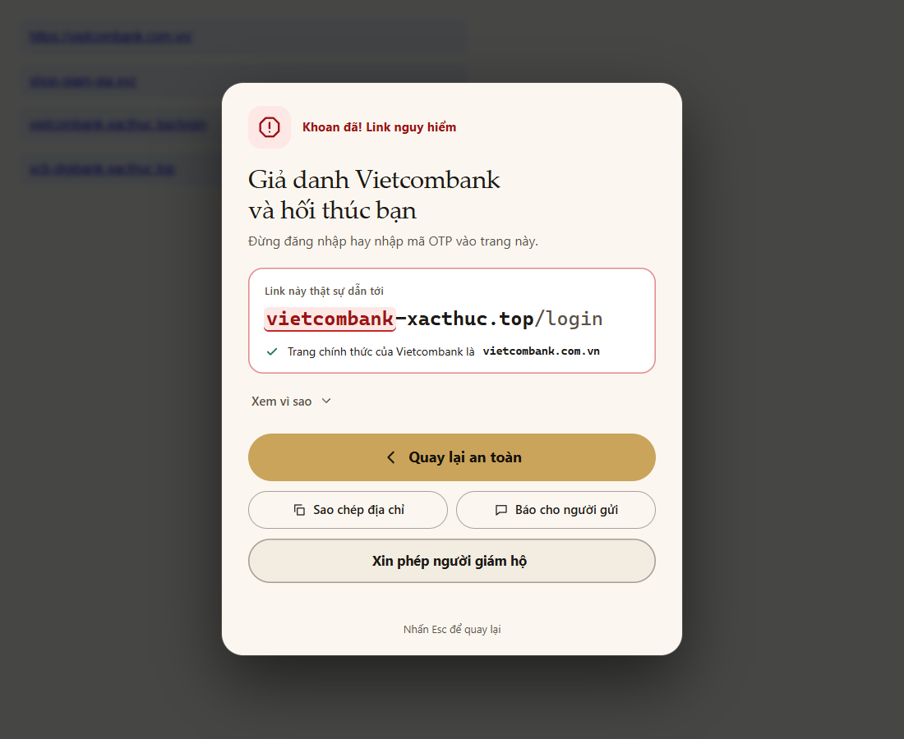 |  |
| 1. Chặn (tối) | — | 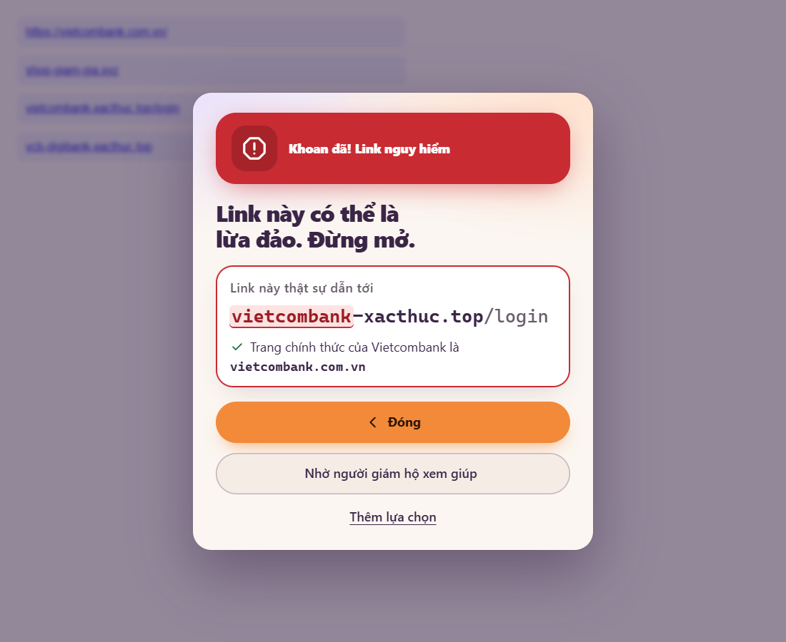 |
| 1. "Thêm lựa chọn" mở ra | (luôn hiện) | 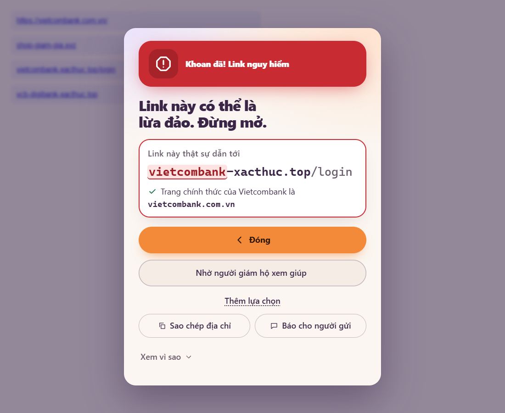 |
| 1. Có tên người giám hộ | — | 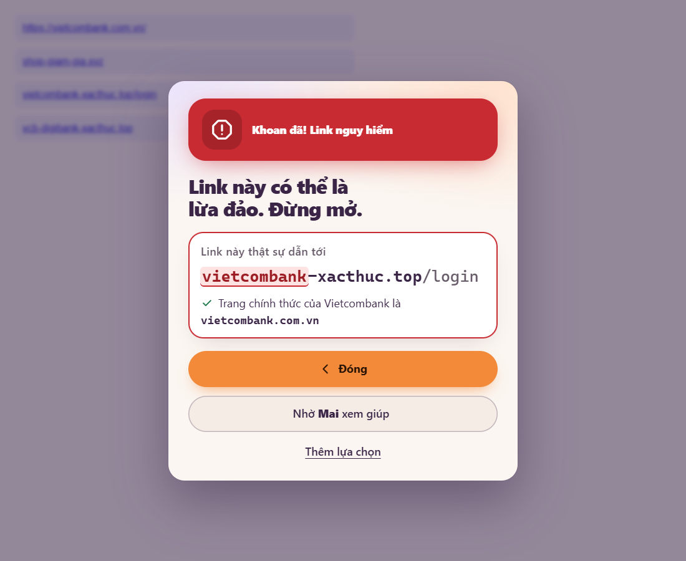 |
| 2. Đã nhờ | 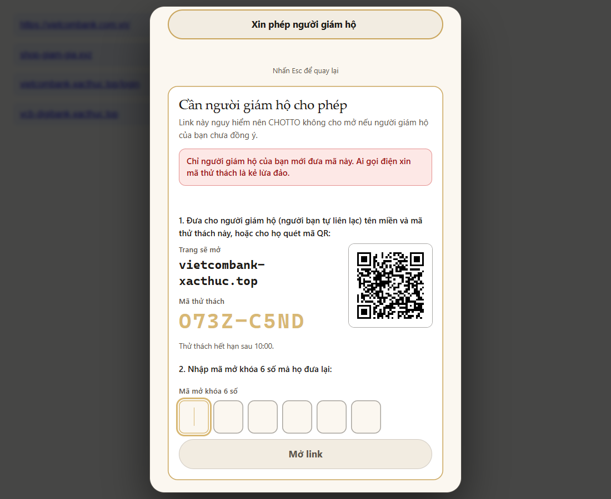 | 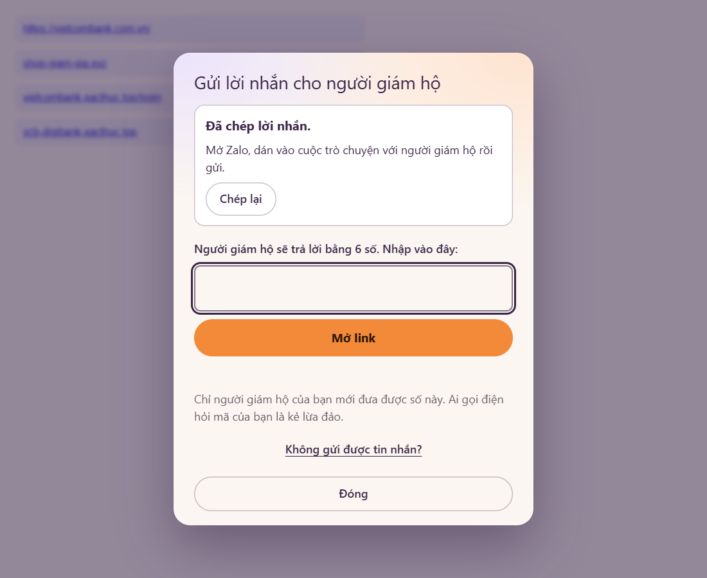 |
| 2. Đã nhờ (tối) | — | 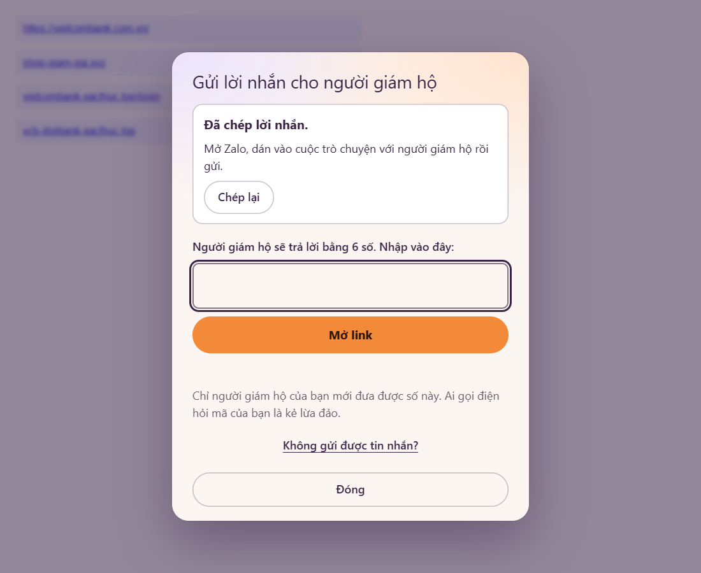 |
| 2. Mã sai, còn 4 lần | (6 ô, thông báo nhỏ) | 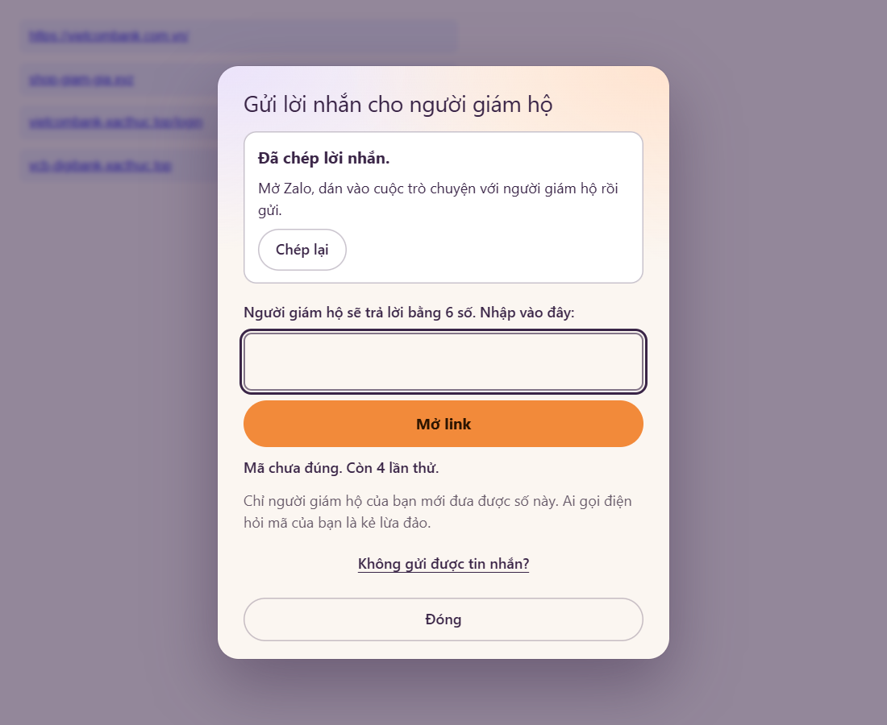 |
| 2. Dự phòng mở ra | (luôn hiện) | 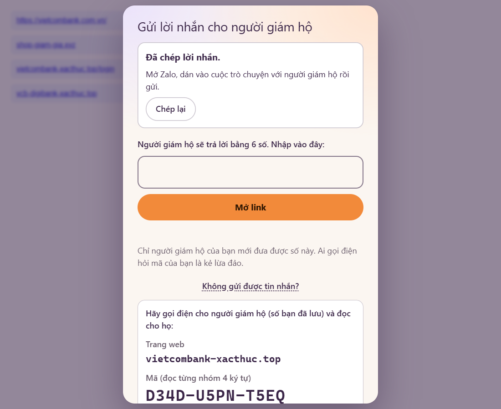 |
| 2. Bị khóa tạm | — | 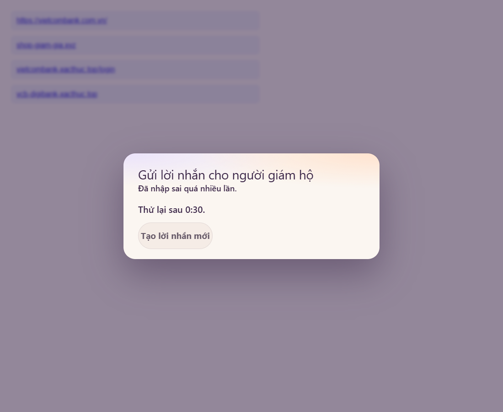 |
| Trang người giám hộ: cài đặt | — | 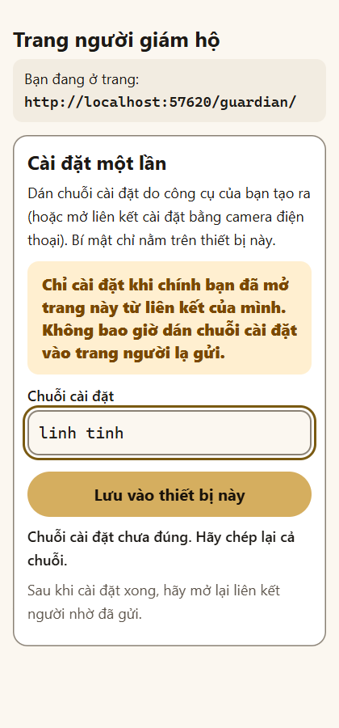 |
| Trang người giám hộ: duyệt link | — | 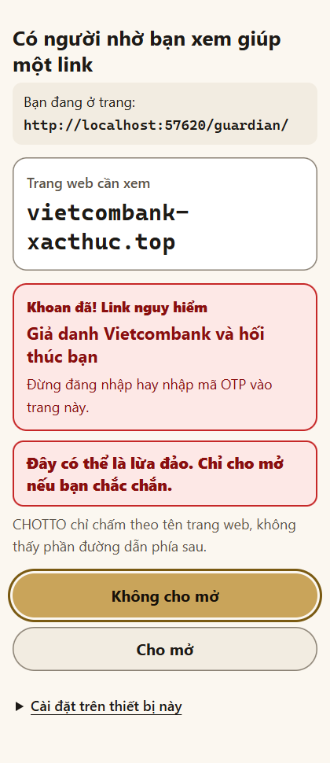 |
| Trang người giám hộ: Không cho mở | — | 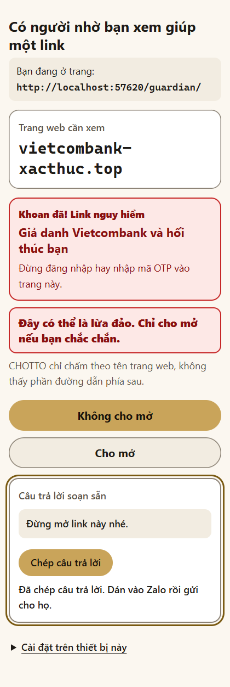 |
| Trang người giám hộ: Cho mở (mã) | — | 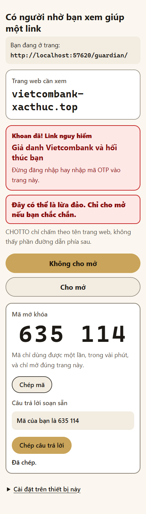 |

### 10.5 Truy cập và tương phản (đã đo)

- Chữ thân ≥ 18px (màn hình trong tiện ích và trang người giám hộ; e2e đo `getComputedStyle`), tiêu đề ≥ 24px, vùng bấm ≥ 48px (e2e đo `boundingBox` trên trang người giám hộ; CSS tiện ích đặt `min-height` 48–58px). Không dựa riêng vào màu: mỗi trạng thái đều có chữ ("Mã chưa đúng", "Đây có thể là lừa đảo…").
- Bàn phím đầy đủ (Tab, Enter gửi mã, `Esc` đóng); `aria-live`/`role="status"` cho lỗi và trạng thái; nút có nhãn truy cập; ô nhập có `<label>`/`aria-label`; tôn trọng `prefers-reduced-motion` (giao diện mới không có hoạt ảnh).
- Tương phản đo bằng `platforms/extension/tests/guardian-contrast.test.mjs` từ **CSS thật** (`chotto/web/shield.css`, `guardian/src/page.css`); test đỏ nếu đổi màu làm tụt dưới ngưỡng (chữ thường ≥ 4,5:1; chữ lớn và viền ô nhập ≥ 3:1). Kết quả lần chạy cuối (`PRINT_CONTRAST=1 node --test tests/guardian-contrast.test.mjs`):

| Cặp màu | Chủ đề | Chữ / nền | Đo được | Cần | Kết quả |
|---|---|---|---|---|---|
| chữ chính trên nền | tiện ích · tối | `#f4efe7` / `#0c0a08` | 17.27:1 | 4.5:1 | đạt |
| chữ chính trên nền | tiện ích · sáng | `#1d1a16` / `#fbf7f0` | 16.23:1 | 4.5:1 | đạt |
| chữ chính trên nền | trang người giám hộ · sáng | `#1d1a16` / `#fbf7f0` | 16.23:1 | 4.5:1 | đạt |
| chữ chính trên nền | trang người giám hộ · tối | `#f4efe7` / `#0c0a08` | 17.27:1 | 4.5:1 | đạt |
| chữ chính trên thẻ | tiện ích · tối | `#f4efe7` / `#161310` | 16.17:1 | 4.5:1 | đạt |
| chữ chính trên thẻ | tiện ích · sáng | `#1d1a16` / `#ffffff` | 17.33:1 | 4.5:1 | đạt |
| chữ chính trên thẻ | trang người giám hộ · sáng | `#1d1a16` / `#ffffff` | 17.33:1 | 4.5:1 | đạt |
| chữ chính trên thẻ | trang người giám hộ · tối | `#f4efe7` / `#161310` | 16.17:1 | 4.5:1 | đạt |
| chữ chính trên nút phụ | tiện ích · tối | `#f4efe7` / `#1f1b16` | 14.96:1 | 4.5:1 | đạt |
| chữ chính trên nút phụ | tiện ích · sáng | `#1d1a16` / `#f2ece1` | 14.74:1 | 4.5:1 | đạt |
| chữ chính trên nút phụ | trang người giám hộ · sáng | `#1d1a16` / `#f2ece1` | 14.74:1 | 4.5:1 | đạt |
| chữ chính trên nút phụ | trang người giám hộ · tối | `#f4efe7` / `#1f1b16` | 14.96:1 | 4.5:1 | đạt |
| chữ phụ trên nền | tiện ích · tối | `#b3aa9d` / `#0c0a08` | 8.61:1 | 4.5:1 | đạt |
| chữ phụ trên nền | tiện ích · sáng | `#5a5248` / `#fbf7f0` | 7.19:1 | 4.5:1 | đạt |
| chữ phụ trên nền | trang người giám hộ · sáng | `#5a5248` / `#fbf7f0` | 7.19:1 | 4.5:1 | đạt |
| chữ phụ trên nền | trang người giám hộ · tối | `#b3aa9d` / `#0c0a08` | 8.61:1 | 4.5:1 | đạt |
| chữ phụ trên thẻ | tiện ích · tối | `#b3aa9d` / `#161310` | 8.07:1 | 4.5:1 | đạt |
| chữ phụ trên thẻ | tiện ích · sáng | `#5a5248` / `#ffffff` | 7.68:1 | 4.5:1 | đạt |
| chữ phụ trên thẻ | trang người giám hộ · sáng | `#5a5248` / `#ffffff` | 7.68:1 | 4.5:1 | đạt |
| chữ phụ trên thẻ | trang người giám hộ · tối | `#b3aa9d` / `#161310` | 8.07:1 | 4.5:1 | đạt |
| chữ trên nút chính | tiện ích · tối | `#17110a` / `#c9a45a` | 7.98:1 | 4.5:1 | đạt |
| chữ trên nút chính | tiện ích · sáng | `#17110a` / `#c9a45a` | 7.98:1 | 4.5:1 | đạt |
| chữ trên nút chính | trang người giám hộ · sáng | `#17110a` / `#c9a45a` | 7.98:1 | 4.5:1 | đạt |
| chữ trên nút chính | trang người giám hộ · tối | `#17110a` / `#c9a45a` | 7.98:1 | 4.5:1 | đạt |
| nhãn mức HIGH | tiện ích · tối | `#ffa598` / `#0c0a08` | 10.43:1 | 4.5:1 | đạt |
| nhãn mức HIGH | tiện ích · sáng | `#9c1414` / `#fbf7f0` | 7.79:1 | 4.5:1 | đạt |
| nhãn mức BLOCKED | tiện ích · tối | `#ffb4a8` / `#0c0a08` | 11.62:1 | 4.5:1 | đạt |
| nhãn mức BLOCKED | tiện ích · sáng | `#8a0f0f` / `#fbf7f0` | 9.12:1 | 4.5:1 | đạt |
| nhãn mức WARN / nhắc hạn | tiện ích · tối | `#f2c986` / `#0c0a08` | 12.68:1 | 4.5:1 | đạt |
| nhãn mức WARN / nhắc hạn | tiện ích · sáng | `#7a4800` / `#fbf7f0` | 7.14:1 | 4.5:1 | đạt |
| chữ cảnh báo đỏ trên nền đỏ nhạt | trang người giám hộ · sáng | `#8a0f0f` / `#fde8e6` | 8.29:1 | 4.5:1 | đạt |
| chữ cảnh báo đỏ trên nền đỏ nhạt | trang người giám hộ · tối | `#ffb4a8` / `#3a1411` | 9.58:1 | 4.5:1 | đạt |
| chữ cảnh báo vàng trên nền vàng nhạt | trang người giám hộ · sáng | `#7a4800` / `#ffefd0` | 6.72:1 | 4.5:1 | đạt |
| chữ cảnh báo vàng trên nền vàng nhạt | trang người giám hộ · tối | `#f2c986` / `#33250c` | 9.55:1 | 4.5:1 | đạt |
| chữ 'an toàn' trên nền xanh nhạt | trang người giám hộ · sáng | `#14573a` / `#e4f4ea` | 7.51:1 | 4.5:1 | đạt |
| chữ 'an toàn' trên nền xanh nhạt | trang người giám hộ · tối | `#9fe0bb` / `#11301f` | 9.45:1 | 4.5:1 | đạt |
| viền ô nhập / thẻ (thành phần giao diện) | trang người giám hộ · sáng | `#8a8174` / `#fbf7f0` | 3.59:1 | 3:1 | đạt |
| viền ô nhập / thẻ (thành phần giao diện) | trang người giám hộ · tối | `#8a8174` / `#0c0a08` | 5.15:1 | 3:1 | đạt |
| viền khung tiêu điểm | trang người giám hộ · sáng | `#7a5a12` / `#fbf7f0` | 5.96:1 | 3:1 | đạt |
| viền khung tiêu điểm | trang người giám hộ · tối | `#e8c987` / `#0c0a08` | 12.36:1 | 3:1 | đạt |
| viền ô nhập (tiện ích: 62% màu chữ) | tiện ích · tối | `rgba(156,152,146,1)` / `#0c0a08` | 6.89:1 | 3:1 | đạt |
| viền ô nhập (tiện ích: 62% màu chữ) | tiện ích · sáng | `rgba(113,110,105,1)` / `#fbf7f0` | 4.75:1 | 3:1 | đạt |

Phát hiện khi đo: viền ô nhập dùng biến `--line-strong` của hệ thiết kế (~2,2:1 ở chế độ sáng) không đạt 3:1, nên ô nhập mã của tiện ích dùng viền riêng `--gd-edge` (62% màu chữ trộn với màu nền).

### 10.6 Kiểm thử khả dụng

Kịch bản, bảng ghi kết quả (để trống) và câu hỏi SUS tiếng Việt nằm ở [`docs/THU-NGHIEM-KHA-DUNG.md`](THU-NGHIEM-KHA-DUNG.md). Bản "cũ" để so sánh là commit `d07e28f`.

## 11. Trang người giám hộ (`guardian/index.html`)

### 11.1 Là gì

Một trang HTML **tĩnh, một file, không máy chủ riêng**: người giám hộ mở liên kết trong lời nhắn, thấy tên trang web cần duyệt to và rõ, mức rủi ro (engine JS của CHOTTO, cùng mã với tiện ích) và một câu lý do đời thường; cảnh báo đỏ nếu HIGH/BLOCKED ("Đây có thể là lừa đảo. Chỉ cho mở nếu bạn chắc chắn."). Hai nút: **Không cho mở** (nút chính; soạn sẵn "Đừng mở link này nhé." và tự chép để dán lại vào Zalo) và **Cho mở** (nút phụ). Bấm *Cho mở* mới hiện mã 6 số chữ rất lớn, nút **Chép mã** và câu trả lời soạn sẵn "Mã của bạn là 123 456" (tự chép). Với link HIGH/BLOCKED, *Cho mở* hỏi lại **một lần** ("Bạn đã gọi lại cho người nhờ bằng số điện thoại quen thuộc để hỏi chưa?") — xem mục 12.

Trang chấm theo **tên trang web** (giống `guardian.py code`), dùng danh sách đen khởi tạo đi kèm; không có danh sách cộng đồng tải về và không có Tầng 3 (tra tuổi tên miền cần mạng). Có ghi chú này ngay trên trang.

### 11.2 Vì sao dữ liệu nằm ở `#fragment`, không phải query

Liên kết: `https://…/guardian/#v=1&d=<trang web>&n=<mã 12 ký tự>`. Phần sau `#` **không bao giờ được trình duyệt gửi đi**: máy chủ host trang, CDN, proxy, nhật ký truy cập và tiêu đề `Referer` của trang khác đều không thấy tên trang web hay mã. Nếu đặt trong query (`?d=…&n=…`) thì mọi nơi trên đường đi (và nhật ký của dịch vụ host) đều lưu lại được. Trang còn đặt `<meta name="referrer" content="no-referrer">`. (Có test: mọi yêu cầu mạng của trang không bao giờ chứa fragment.)

### 11.3 Cài đặt một lần và lưu bí mật

- `python tools\guardian.py export-guardian` in **chuỗi cài đặt** `CHOTTO-GUARDIAN-SETUP-v1:<bí mật>`; `--html` tạo `guardian-setup.html` (ngoài repo, quyền chỉ chủ sở hữu, có **mã quét** dựng offline bằng `qrcode-generator`). Người giám hộ quét mã bằng camera điện thoại (mở liên kết `…/guardian/#setup=<bí mật>`) hoặc dán chuỗi vào ô "Chuỗi cài đặt", rồi bấm **Lưu vào thiết bị này**. Liên kết `#setup=` **không tự lưu**: phải bấm; sau khi lưu trang xóa fragment khỏi thanh địa chỉ (`history.replaceState`).
- Bí mật lưu trong `localStorage` của **origin trang đó** (khóa `chotto-guardian-secret-v1`, base64url). Có nút **Xóa khỏi thiết bị này** (hỏi lại một lần).
- **Rủi ro (nói thẳng):** ai mở được trình duyệt đó trên điện thoại đang mở khóa đều tính được mã (`localStorage` không mã hóa). Vì vậy: **đặt khóa màn hình**; đừng cài trên máy dùng chung; mất máy thì đổi bí mật (`init --force`, `make-reg`, Merge `.reg`; các máy cũ mất hiệu lực) và nếu còn truy cập được thì bấm "Xóa khỏi thiết bị này". Camera quét/ứng dụng quét mã có thể lưu lịch sử liên kết `#setup=`: xóa lịch sử quét sau khi cài. Chuỗi cài đặt cũng có thể gõ tay thay vì quét.
- Nếu host trên `*.github.io`, mọi trang của cùng tài khoản dùng chung *origin* và `localStorage`: nên host trang ở **tên miền riêng** (hoặc kho riêng) để trang khác không đọc được bí mật.
- Bí mật chỉ cho phép *tính mã*, không cho phép ký chính sách (khóa Ed25519 riêng tư không bao giờ ở trang này).

### 11.4 CSP, không gọi mạng và mô hình đe dọa của trang

- CSP trong thẻ `<meta>`: `default-src 'none'; script-src 'sha256-…'; style-src 'sha256-…'; img-src data:; connect-src 'none'; worker-src 'self'; base-uri 'none'; form-action 'none'`. Không có `unsafe-inline`/`unsafe-eval`; script và style ghim bằng băm SHA-256. **`connect-src 'none'`** chặn `fetch`, XHR, WebSocket, beacon: trang không thể gọi mạng dù có lỗi (test e2e bắn `fetch` ra ngoài và thấy vi phạm CSP; test khác theo dõi mọi yêu cầu của trình duyệt).
- Chạy offline sau lần tải đầu: một service worker nhỏ (`sw.js`, cùng thư mục) giữ một bản của trang và làm mới nền khi có mạng. **Chính trang không gọi mạng**; chỉ service worker tải lại trang từ nơi host. (Có e2e: tắt mạng, tải lại, vẫn tính được mã.) Mở từ `file://` cũng chạy (không có service worker).
- **Chuỗi cung ứng:** người host trang là bên tin cậy: nếu bản trang bị thay bằng bản độc hại thì có thể lấy bí mật của lần dùng sau. Giảm thiểu: host kho/tên miền riêng, bật xác thực hai lớp cho tài khoản host, đối chiếu băm script (hiện trong CSP của trang đã dựng; `python tools/build_guardian_page.py --check` dựng lại từ mã nguồn để so), hoặc **tải trang về lưu trên điện thoại** (`file://`/"Thêm vào màn hình chính") để không phụ thuộc nơi host.
- **Liên kết giả gửi cho người giám hộ** (A7): xem bảng mục 4.1. Trang luôn hiện "Bạn đang ở trang: <địa chỉ>" ngay đầu màn hình; bí mật gắn với origin nên trang khác không tính được mã; mã chỉ mở đúng trang đã bị chặn. Phần chưa chặn được là người giám hộ bị lừa **dán bí mật vào trang giả**.
- Không có `frame-ancestors` (không đặt được trong `<meta>`): trang có thể bị nhúng khung; mã hiển thị trong khung không đọc được bởi trang cha khác origin, nên rủi ro thấp.

### 11.5 Host trang (không tự bật, không tự push)

Trang là một thư mục tĩnh `guardian/` (`index.html`, `sw.js`). Cách đơn giản nhất với GitHub Pages: trong kho của bạn vào *Settings → Pages* chọn nhánh và thư mục gốc; trang sẽ có ở `https://<tài khoản>.github.io/<kho>/guardian/`. (Kho này đã dùng Pages cho `index.html` ở gốc, nên `guardian/` cũng được phục vụ cùng nơi khi nhánh chứa nó được xuất bản.) Việc bật Pages và push **do bạn làm**; dự án này không làm hộ. Hoặc chép thư mục `guardian/` lên bất kỳ máy chủ tĩnh nào (Netlify, Cloudflare Pages, nginx), hoặc mở thẳng `guardian/index.html` từ đĩa/USB. Sau đó đặt địa chỉ cho tiện ích bằng `make-reg --page-url` (phải là `https://`) và Merge lại `.reg`.

`.gitattributes` ghim `guardian/index.html` ở LF vì CSP ghim băm: nếu Git đổi sang CRLF thì băm lệch và trình duyệt chặn script.

### 11.6 Dựng lại

Sửa nguồn ở `guardian/src/` (`page.html`, `page.css`, `page.js`) hoặc mã dùng chung (`platforms/extension/src/engine`, `view.js`, `guardian/codec.js`, `share.js`, `platforms/extension/data`) rồi chạy `python tools/build_guardian_page.py`. Test Python kiểm tra file dựng sẵn luôn khớp nguồn. Bộ dựng tự viết (không thêm thư viện): chuyển module ES thành hàm tự gọi, nhúng dữ liệu, tính băm CSP.

## 12. Quyết định kỹ thuật (làm khác hoặc thêm so với yêu cầu)

- **Bộ đếm sai toàn cục.** Yêu cầu nói "5 lần/thử thách" và "khóa tăng dần toàn tiện ích". Nếu chỉ đếm theo thử thách, B đổi thử thách (bấm lại link) là có 5 lượt mới. Nên: mỗi thử thách vẫn tối đa 5 lượt, **cộng thêm** bộ đếm sai liên tiếp toàn cục (không reset khi đổi thử thách; reset khi mở đúng hoặc sau 1 giờ yên). Cứ 5 lần sai liên tiếp → khóa 30 s, 2 phút, 10 phút và **hủy mọi thử thách**.
- **Thử thách phát *lười*** khi bấm "Xin phép" (không phát lúc hiện cảnh báo): nonce chỉ tồn tại khi thật sự được hỏi, đồng hồ 10 phút chỉ chạy từ lúc đó.
- **Lưu thử thách ở `storage.local` có kèm `bootId`** (so với `storage.session`): bộ đếm và thử thách cùng một kho, nên xóa bộ đếm thì thử thách mất theo (như yêu cầu), nhưng vẫn hủy khi trình duyệt khởi động lại vì `bootId` ở `storage.session` mất.
- **`BLOCKED` luôn cần mã.** Chính sách ký không nới được `BLOCKED` và danh sách "luôn cho phép" không áp dụng cho `BLOCKED` (danh sách đen thắng).
- **Managed đọc lỗi** (ví dụ chưa có schema): dùng bản đọc tốt gần nhất trong bộ nhớ service worker; nếu chưa từng đọc được thì coi như Guardian tắt (khớp yêu cầu "managed thiếu → hành vi cũ"). Hệ quả: lần khởi động đầu tiên mà managed lỗi thì Guardian tắt (đã nêu ở mục 6).
- **`content.js` dự phòng:** khi không liên lạc được service worker, màn hình dự phòng cho phép "vẫn mở" sau 5 giây; nếu `chrome.storage.managed` cho thấy Guardian bật thì ẩn hẳn nút đó (fail-closed). Nếu chính content script bị vô hiệu (ngữ cảnh tiện ích bị hủy) thì không còn gì chạy, đây là giới hạn B12.
- **Tiện ích chỉ chấm domain đăng ký ở dạng ASCII (punycode).** Công cụ giám hộ chuẩn hóa tên miền Unicode sang punycode (IDNA); màn hình hiện dạng ASCII để người giám hộ và công cụ thấy cùng một chuỗi.
- **QR dùng thư viện đã kiểm chứng** `qrcode-generator` 1.4.4 (MIT) chép vào `src/vendor/` (không sửa), thay vì tự viết bộ mã hóa QR.
- **`guardian.html` không chấm lại được tên miền** (không có engine Python trong trình duyệt): thay bằng cảnh báo "CHOTTO chỉ hiện thử thách khi đã chấm nguy hiểm", bắt tick xác nhận đã gọi lại người thân, và gợi ý dùng `guardian.py code` nếu có máy tính.
- **Ba file `.reg` thay vì hai:** thêm file làm cứng tách riêng vì hai policy làm cứng phá vỡ demo load unpacked.
- **Khóa ghim ID bằng RSA-2048** theo cách Chrome tính ID (`SHA-256` của khóa công khai → `a–p`); `key` bị bỏ khỏi bản Firefox.
- **`ExtensionInstallForcelist` không được ghi vào `.reg`** vì chưa kiểm chứng được; chỉ nêu trong tài liệu.

### Quyết định của lần làm lại UX (tự quyết, không hỏi lại)

- **Bộ chữ nonce 31 ký tự, 12 ký tự** (mục 5): bỏ `I L O 0 1` đúng yêu cầu; 31 không phải lũy thừa của 2 nên 8 ký tự chỉ có 39,6 bit < 40, nên tăng lên 12 (3 nhóm 4). Dùng lấy mẫu loại bỏ thay vì `mod` thẳng để không lệch phân bố. Nonce 8 ký tự cũ **không còn được nhận** (thử thách chỉ sống 10 phút nên không cần tương thích ngược).
- **Liên kết thay cho "đọc mã"**: đường chính là lời nhắn + liên kết tới trang người giám hộ; mã đọc bằng miệng và hình vuông quét chỉ là dự phòng. Nội dung hình vuông quét đổi từ `CHOTTO-GUARDIAN-v1|tên miền|nonce` sang chính liên kết (camera điện thoại mở thẳng trang). `guardian.py code` vẫn nhận cả dạng cũ, dạng `tên-miền mã`, và liên kết.
- **Tên trang web trong lời nhắn viết `abc[.]top`**: Zalo tự biến chuỗi giống tên miền thành liên kết bấm được; nếu người giám hộ lỡ chạm vào tên trang lừa đảo thì mở thẳng trang đó. Liên kết duy nhất bấm được là trang người giám hộ. Hơi "kỹ thuật" nhưng an toàn hơn; người giám hộ không phải đọc nó (trang tự hiển thị tên thật).
- **`Cho mở` hỏi lại một lần với link HIGH/BLOCKED** ("đã gọi lại cho người nhờ bằng số quen thuộc chưa?"): yêu cầu chỉ nói "hai nút", nhưng đây là bước người giám hộ thật sự cần (A2). Link an toàn/WARN không hỏi lại. Nếu bạn muốn đúng một chạm tuyệt đối, bỏ nhánh `danger` trong `guardian/src/page.js` (hàm `allowBtn`).
- **`guardian_page_url` và `guardian_name` chỉ đọc từ managed storage** (cùng gốc tin cậy với bí mật): trang Zalo và content script không bao giờ đưa được địa chỉ vào lời nhắn. Địa chỉ phải là `https://` (hoặc `http://localhost` để thử), không có tài khoản/mật khẩu; sai thì dùng mặc định. Mặc định `https://sanhkhoa57.github.io/CHOTTO/guardian/` là suy ra từ remote của repo; **bạn cần host trang hoặc đặt `--page-url`** (chưa có gì được bật hay đẩy lên).
- **Trang người giám hộ một file, bộ dựng tự viết**: ES module bị chặn trên `file://` và CSP chỉ ghim được băm của khối nội tuyến, nên một file nội tuyến + băm SHA-256 là cách duy nhất vừa mở được từ đĩa vừa không cần `unsafe-inline`. Không thêm bundler; bộ dựng chỉ hiểu các dạng `import`/`export` mà engine dùng và từ chối dạng lạ (có test).
- **Service worker cho offline**: chỉ để trang mở được khi mất mạng; trang không gọi mạng (CSP), service worker thì có (để làm mới bản lưu). Tuyên bố "không gọi mạng" nói về trang. Bạn có thể bỏ `sw.js` và `worker-src` nếu muốn tuyệt đối không có yêu cầu mạng nào sau lần tải đầu (lúc đó offline dựa vào bộ nhớ đệm trình duyệt hoặc lưu file).
- **Chuỗi cài đặt/liên kết `#setup=`**: QR của `export-guardian --html` mở liên kết cài đặt để dùng camera điện thoại thông thường (không cần ứng dụng quét trong trang); đổi lại bí mật đi qua một liên kết (lịch sử camera). Đã nêu ở 11.3; có thể dán chuỗi thay vì quét.
- **Giữ nguyên tool cũ** (`guardian.html`, `make-html`): chỉ sửa bộ chữ nonce và nhận liên kết.
- **Không sửa engine chấm điểm và `chotto/data/rules.json`** (đúng yêu cầu); trang người giám hộ dùng nguyên `platforms/extension/src/engine`.
- **Bỏ ảnh cũ** `docs/guardian/01..05-*.png` (giao diện đã đổi); ảnh mới ở `docs/guardian/ux/` (giữ `04-settings.png` vì trang cài đặt không đổi).
